# Epsilon Engine

Motor 3D extraído de **Proyecto Epsilon**. Sustituye la proyección manual de `GRAFICOS.cpp` por matrices 4×4 y separa la simulación del dibujado para aprovechar varios núcleos.

Es una librería modular para el juego que nacerá de este. Simula una galaxia a escala real, con órbitas elípticas, estrellas, planetas de materiales, asteroides, nebulosas volumétricas y agujeros negros con lente gravitacional. En la misma escena dibuja modelos 2D y 3D a escala humana, para reparar una estación en órbita de un planeta. Cada parte se activa o desactiva con comandos. Faltan los menús del juego y el audio.

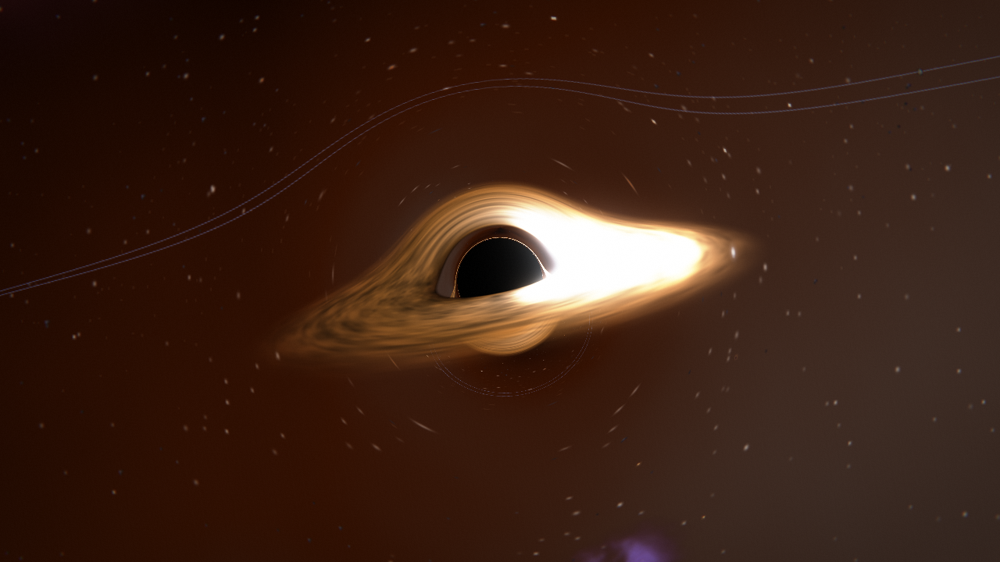

Para usarlo en otro juego, empieza por [Usarlo como librería](#usarlo-como-librería). Para el simulador, ve a [Sistemas solares realistas](#sistemas-solares-realistas), para la escala humana a [Del tornillo al año luz](#del-tornillo-al-año-luz) y para el panel a [Interfaz](#interfaz).

El juego que usa este motor está en [game/](game/README.md).

## Compilar en Visual Studio 2026

1. Abre esta carpeta con **Archivo > Abrir > Carpeta**.
2. Elige el preset `x64 SDL Release` o `x64 SDL Debug`.
3. Compila con **Compilar > Compilar todo**.
4. Selecciona `epsilon_window.exe` como elemento de inicio y ejecútalo.
5. Ejecuta las pruebas con **Prueba > Ejecutar CTest**.

Los presets `x64 Release`, `x64 Debug` y `x64 AddressSanitizer` compilan solo el núcleo y no necesitan SDL3, así que tampoco generan `epsilon_window.exe`.

No abras archivos `.sln` ni `.vcxproj` de la carpeta `out`. Son copias temporales del código de SDL3 que vcpkg deja allí, y este motor no los usa. Sus ejemplos piden el conjunto de herramientas `v143` de Visual Studio 2022, por eso fallan con el error `MSB8020` en Visual Studio 2026. Si te ocurre, usa **Archivo > Cerrar solución**, vuelve a abrir esta carpeta y compila con los presets. No hace falta instalar `v143` ni actualizar la solución.

Si borras la carpeta `out`, vcpkg tendrá que recompilar SDL3. Este equipo tiene Avast inspeccionando TLS, y eso puede hacer fallar a git con el error `the certificate chain is incomplete`. Esta configuración de git lo resuelve sin desactivar la verificación:

```bash
git config --global http.sslBackend openssl
```

```bash
git config --global http.sslCAInfo "C:/ProgramData/Avast Software/Avast/wscert.pem"
```

### Ventana

Controles de `epsilon_window`:

| Entrada | Acción |
|---|---|
| Ratón | Mirar |
| W, A, S, D | Mover |
| Q, E | Bajar, subir |
| Shift izquierdo | Multiplicar la velocidad por 6 |
| H | Mostrar u ocultar la interfaz |
| Clic izquierdo | Seleccionar la roca apuntada o, si no hay, el cuerpo más cercano al punto de mira |
| N, P | Seleccionar el siguiente o el anterior de la lista |
| F | Saltar al cuerpo seleccionado y seguirlo. En un campo, viajar al cúmulo más cercano |
| Tab | Saltar al siguiente cuerpo del sistema y seguirlo |
| Retroceso | Dejar de seguirlo |
| Coma, punto | Menos o más tiempo simulado por segundo |
| Espacio | Pausar el tiempo |
| O | Mostrar u ocultar las órbitas |
| J | Entrar o salir de la estación, a escala humana |
| R | Reparar el panel apuntado, a menos de 8 m |
| F1 | Abrir la consola de comandos; escribe `ayuda` |
| Esc | Salir, o cerrar la consola |

La velocidad es proporcional a la distancia a la superficie más cercana, así que el mismo control sirve para cruzar años luz y para maniobrar a pocos kilómetros. En la estación se mide en metros por segundo: 3 m/s, o 12 m/s con Shift. La cámara no puede entrar en los cuerpos. La barra de título muestra los FPS, el lugar, la fecha simulada, la velocidad del tiempo y lo que hay cargado.

```bash
epsilon_window --frames 240 --screenshot captura.png
```

Esa orden usa una cámara automática, termina sola y guarda el último fotograma. Otras opciones:

| Opción | Efecto |
|---|---|
| `--focus tipo` | Sigue un cuerpo: `star`, `lava`, `rock`, `desert`, `terra`, `ice`, `hot`, `gas`, `icegiant`, `moon`, `comet`, `asteroid`, `blackhole`, `schwarzschild`, `kerr`, `supermassive` o `asteroids` |
| `--still` | La cámara automática no gira; sirve para mirar una explosión |
| `--eva` | Empieza junto a la estación, a escala humana |
| `--repair N` | Repara N paneles al empezar, con el mismo rayo que la tecla R |
| `--model archivo` | Coloca junto a la estación un `.obj`, `.gltf` o `.glb` |
| `--cmd "texto"` | Ejecuta un comando al empezar; se puede repetir |
| `--config archivo` | Ejecuta un archivo de comandos |
| `--systems N` | Número de sistemas |
| `--no-streaming` | Crea todos los cuerpos al empezar |
| `--system N` | Busca el cuerpo o sitúa la cámara en ese sistema |
| `--view top` | Mira el sistema desde arriba |
| `--radii X` | Distancia al cuerpo enfocado, en radios |
| `--days D` | Empieza en el día D simulado |
| `--timescale X` | Segundos simulados por segundo real; por defecto, 86 400 |
| `--seed N` | Genera otra galaxia |
| `--real-frequencies` | Usa la proporción real de estrellas |
| `--describe archivo` | Escribe los datos y las ecuaciones de todos los cuerpos |
| `--routes` | Dibuja las rutas entre sistemas del juego original |
| `--no-orbits` | Oculta las órbitas |
| `--no-hud` | Empieza con la interfaz oculta |
| `--select tipo` | Selecciona un cuerpo sin mover la cámara; `belt` elige un campo de asteroides |
| `--size ancho alto` | Tamaño de la ventana |
| `--models carpeta` | Carpeta con `catalogo.tsv` |
| `--hold teclas`, `--tab N`, `--click` | Simulan teclas: `w a s d q e`, `f` para Shift, Tab y un clic al empezar |
| `--no-vsync` | Dibuja sin esperar al monitor, para medir |
| `--no-lod` | Dibuja todas las esferas con el detalle máximo |
| `--assets carpeta`, `--debug` | Carpeta de recursos y capa de depuración |

`epsilon_minimal` es el juego más pequeño posible sobre la librería. `epsilon_system` no abre ventana: genera un sistema e imprime sus ecuaciones.

### Sin ventana

El programa `epsilon_demo` tiene cuatro modos:

```bash
epsilon_demo render salida.bmp
```

```bash
epsilon_demo bench 300000
```

```bash
epsilon_demo threaded 600
```

```bash
epsilon_demo streaming 5000
```

## Usarlo como librería

El motor se compila en módulos. Cada uno se enlaza solo, y el juego elige cuáles usa.

| Módulo | Destino de CMake | Qué trae | Depende de | Se apaga con |
|---|---|---|---|---|
| Núcleo | `epsilon::core` | Matemáticas, cámara, escena, hilos, comandos, `FrameBuilder` y `Mesh` | Nada | No se apaga |
| Astral | `epsilon::astro` | Órbitas, sistemas, carga bajo demanda, asteroides, nebulosas y agujeros negros | `core` | `EPSILON_MODULE_ASTRO=OFF` |
| Modelos | `epsilon::models` | Mallas, OBJ, glTF y burbujas a escala humana | `core` | `EPSILON_MODULE_MODELS=OFF` |
| GPU | `epsilon::sdl` | Backend SDL_GPU y todos los shaders | `core`, SDL3 | No lo pongas en `EPSILON_WITH_SDL` |
| Interfaz | `epsilon::hud` | Panel sci-fi | `astro`, `sdl`, Dear ImGui | `EPSILON_MODULE_HUD=OFF` |
| Fachada | `epsilon::engine` | La clase `Engine`, que une lo astral y los modelos | `astro`, `models` | Sin alguno de los dos |

`astro` y `models` no se conocen entre sí, y eso es lo que separa las dos escalas. Lo único que comparten es el nodo donde se engancha una burbuja y la dirección del sol. `epsilon::engine` tampoco conoce SDL: la ventana, la GPU y los hilos los decide el juego.

### Instalarla

Compila con el preset `x64-sdl-release` e instala en una carpeta:

```bash
cmake --install out/build/x64-sdl-release --prefix C:/libs/epsilon
```

En el proyecto nuevo basta con esto, añadiendo `C:/libs/epsilon` a `CMAKE_PREFIX_PATH`:

```cmake
find_package(EpsilonEngine CONFIG REQUIRED)
add_executable(mi_juego main.cpp)
target_link_libraries(mi_juego PRIVATE epsilon::engine epsilon::sdl)
```

El proyecto nuevo necesita su propio `vcpkg.json` con `sdl3` y, si usa la interfaz, `imgui[sdlgpu3-binding]`. Hay que copiar `SDL3.dll` junto al ejecutable.

También sirve `add_subdirectory(EpsilonEngine)` con `EPSILON_WITH_SDL` activado. Así el motor no compila sus ejemplos ni sus pruebas.

### El juego más pequeño

Este es el centro de [minimal_game.cpp](demo/minimal_game.cpp). Ya incluye sistemas, carga bajo demanda, agujeros negros y nebulosa:

```cpp
EngineConfig config;
config.galaxy.streaming = true;
config.galaxy.blackHoles = true;
config.galaxy.nebulae = 2;
Engine engine(config);
engine.Commands().Execute("desactivar grano");

while (running) {
    engine.Advance(camera.Position(), camera.FocalPx(), simTime);  // simulación
    engine.Build(camera, time, packet);                            // fotograma
    backend.Render(packet);
}
```

Para llevar la simulación a otro hilo, añade un `TripleBuffer<FramePacket>`: la simulación llama a `Build` sobre `WriteSlot()` y a `Publish()`, y el hilo principal llama a `AcquireLatest()` y dibuja `ReadSlot()`. [window_demo.cpp](demo/window_demo.cpp) lo hace completo.

### Comandos

Todo se activa y desactiva con texto, así que una consola, un archivo de opciones o la línea de órdenes usan el mismo camino. Apagar algo elimina su trabajo, no solo su dibujo.

| Comando | Efecto |
|---|---|
| `activar nebulosa`, `desactivar bloom grano` | Enciende o apaga una o varias funciones; `todo` las incluye a todas |
| `alternar orbitas` | Cambia el estado |
| `estado` | Lista las funciones y su estado |
| `fijar bloom.fuerza 0.8` | Cambia una variable; sin valor, la muestra |
| `cargados` | Cuenta lo que hay en memoria |
| `impactos` | Lista los choques pendientes y los últimos ocurridos |
| `ayuda` | Lista los comandos |

Funciones: `cielo`, `nebulosa`, `asteroides`, `agujeros`, `modelos`, `orbitas`, `rutas`, `hud`, `bloom`, `vineta`, `aberracion`, `grano`, `streaming`, `descarte` y `colisiones`.

Variables: `bloom.fuerza`, `bloom.umbral`, `exposicion`, `vineta.fuerza`, `aberracion.fuerza`, `grano.fuerza`, `detalle` y `colision.rocas`, que son los choques espontáneos por minuto en el campo donde estás.

También valen `on`, `off`, `toggle`, `set` y `help`. El juego añade los suyos con `Commands().Add("nombre", "ayuda", funcion)`. `epsilon_window` añade `ir kerr`, `ir estacion`, `ir asteroides`, `ir binaria`, `ir abierta`, `ir triple`, `ir cuadruple`, `ir inestable`, `tiempo 3600`, `efecto cabina on` y `chocar`.

Un archivo de comandos admite comentarios con `#`:

```text
# ajustes del juego
desactivar grano vineta
fijar bloom.fuerza 0.3
```

## Arquitectura modular

Cada capa solo conoce a la de abajo, así que puedes cambiar el juego o la API gráfica sin tocar lo demás.

```text
┌─ TU JUEGO ──────────────────────────────────────────────────────────┐
│  Reglas, combate, IA, inventario, guardado                          │
└───────────────┬─────────────────────────────────────────────────────┘
                │ Engine: comandos, Advance y Build
┌─ MÓDULOS ▼ (cada uno aporta una capa al fotograma) ─────────────────┐
│  astro    Universe, Kepler, Astro, Asteroids, BlackHole, Collisions │
│  models   Models: mallas, archivos, LocalSpace                      │
└───────────────┬─────────────────────────────────────────────────────┘
                │ IFrameLayer: añade instancias, solo lectura
┌─ NÚCLEO ▼ (no sabe qué juego es ni qué API usa) ────────────────────┐
│  SceneGraph    posición y jerarquía                                 │
│  Camera        matrices, frustum, selección de objetivo             │
│  FrameBuilder  recorta, elige sprite o esfera, ordena y agrupa      │
│  JobSystem     trabajo en paralelo                                  │
│  Features      interruptores y consola de comandos                  │
└───────────────┬─────────────────────────────────────────────────────┘
                │ FramePacket: copia sin punteros al mundo
┌─ BACKEND ▼ (IRenderBackend: la única parte que toca la API) ────────┐
│  SdlGpuBackend + shaders: Direct3D 12                               │
│  IGpuOverlay: capa opcional encima de la escena                     │
│  SoftwareBackend: CPU, para referencia y pruebas sin ventana        │
└─────────────────────────────────────────────────────────────────────┘
```

### Mapa de archivos

| Módulo | Archivo en `engine/` | Responsabilidad |
|---|---|---|
| core | `Math3D.h` | Vectores, matrices y cuaterniones |
| core | `JobSystem.h`, `.cpp` | Reparto determinista de trabajo entre núcleos |
| core | `TripleBuffer.h` | Último fotograma disponible, sin bloqueos |
| core | `SceneGraph.h`, `.cpp` | Nodos, jerarquía y retirada de nodos |
| core | `Features.h`, `.cpp` | Interruptores y consola de comandos |
| core | `Layer.h` | `IFrameLayer`, el punto de unión con los módulos |
| core | `Mesh.h` | Datos de una malla, sin GPU |
| core | `RenderTypes.h` | `Renderable`, `FramePacket`, `IRenderBackend` |
| core | `Camera.h`, `.cpp` | Proyección, frustum y selección |
| core | `FrameBuilder.h`, `.cpp` | Convierte la escena en un `FramePacket` |
| core | `SoftwareBackend.h`, `.cpp` | Dibujado por CPU a BMP |
| astro | `Kepler.h`, `.cpp` | Elipses, giro y ecuaciones en texto |
| astro | `Astro.h`, `.cpp` | Estrellas, planetas, lunas, materiales y estabilidad |
| astro | `BlackHole.h`, `.cpp` | Fórmulas de los dos tipos y el integrador de rayos |
| astro | `Asteroids.h`, `.cpp` | Cinturones, perfiles, familias y campos |
| astro | `Collisions.h`, `.cpp` | Choques: detección, trayectorias y explosiones |
| astro | `Universe.h`, `.cpp` | Convierte sistemas en escena y los carga bajo demanda |
| astro | `AstroLayers.h`, `.cpp` | Órbitas, nebulosas, lentes y rocas en cada fotograma |
| models | `Models.h`, `.cpp` | Mallas, OBJ, glTF, `LocalSpace` y `ModelLayer` |
| sdl | `SdlGpuBackend.h`, `.cpp` | Convierte el paquete en comandos de GPU |
| sdl | `shaders/epsilon.hlsl` | Sprites, líneas y fondo |
| sdl | `shaders/sphere.hlsl` | Esferas y superficies procedurales |
| sdl | `shaders/mesh.hlsl` | Mallas con instancias |
| sdl | `shaders/nebula.hlsl` | Nubes volumétricas |
| sdl | `shaders/blackhole.hlsl` | Lente gravitacional y disco |
| sdl | `shaders/post.hlsl` | Bloom, curva de tono y efectos de lente |
| sdl | `shaders/effects/` | Ejemplo de efecto propio del juego |
| hud | `HudModel.h`, `SciFiHud.h`, `.cpp` | Interfaz |
| engine | `Engine.h`, `.cpp` | Fachada |

`demo/` no forma parte de la librería. `DemoStation.h` construye la estación usando solo la API pública. `tools/generar_modelos.py` crea los modelos de `assets/modelos`.

### Flujo de datos

| Dato | Quién lo escribe | Quién lo lee | Cuándo cambia |
|---|---|---|---|
| `StarSystemData` | `Astro` | `Universe` | Al cargar un sistema |
| `KeplerOrbit` | `Universe` | `UpdateOrbits`, `OrbitLayer` | Al cargar un sistema |
| `Transform` | `UpdateOrbits` y juego | `SceneGraph` | Cada paso |
| `Renderable` | `Universe` | `FrameBuilder` | Al cargar o descargar |
| `SurfaceLook` | `Universe` | Backend | Al cargar; cada cambio publica una copia |
| `WorldCatalog` | `Universe` | Interfaz | Al cargar; es inmutable y cruza entre hilos |
| `Camera`, `time`, `simTime`, `LodSettings` | Juego | `FrameBuilder` | Cada paso |
| `FramePacket` | `FrameBuilder` y capas | Backend | Cada fotograma; nunca se modifica después |
| `HudFrame` | Simulación | `SciFiHud` | Cada fotograma; viaja junto al `FramePacket` |

### Tres reglas para no romper la separación

1. Solo el backend incluye `SDL_gpu`. Los datos y `FrameBuilder` no deben conocerlo.
2. `FramePacket` no lleva punteros al mundo. Por eso el dibujado puede estar en otro hilo.
3. Dibujar no cambia el estado. La órbita, el giro y el titileo son funciones del tiempo, y lo que deba cambiar se actualiza en la simulación.

### Puntos de extensión

| Quieres | Qué cambiar |
|---|---|
| Otro tipo de planeta | Un valor en `SurfaceKind` y un `case` en `PSSphere` |
| Otro aspecto del mismo tipo | Solo una entrada de `SurfaceLook` |
| Otro material | Un campo en `Materials`, su efecto en `DeriveAppearance` y su reparto en `SampleMaterials` |
| Otra interfaz | Una clase con `IGpuOverlay`; `HudModel.h` no depende de cómo se dibuje |
| Otro movimiento | Una función como `UpdateOrbits` que escriba en `Transform` |
| Otra regla de generación | Las tablas y fórmulas de `Astro.cpp`; `CheckStability` comprueba el resultado |
| Más modelos | `generar_modelos.py --variantes 12`; el juego lee `catalogo.tsv` al arrancar |
| Más o menos calidad | `LodSettings`, en cada `FrameInput` |
| Vulkan u otra API | Una clase nueva con `IRenderBackend`; el resto no cambia |
| Un módulo propio | Una clase con `IFrameLayer`, registrada con `AddLayer`: añade instancias al fotograma |
| Un efecto de pantalla | Un shader como `effects/scanlines.hlsl`, compilado con `epsilon_add_shader` y registrado con `AddPostEffect` |
| Un comando | `Commands().Add("nombre", "ayuda", funcion)` |

## Sistemas solares realistas

Una unidad del motor es **un kilómetro**, y un segundo simulado es un segundo real. Por defecto el tiempo corre a un día por segundo. Las cifras, sus fuentes y lo que se simplificó están en [astrofisica.md](docs/astrofisica.md).

| Escala | Valor en el simulador |
|---|---|
| Radio de una estrella | De 11 km (neutrones) a unos 1000 millones de km (supergigante roja) |
| Radio de un planeta | Unos 1800–70 000 km; los Júpiter calientes llegan a unos 120 000 km |
| Radio de una luna | Unos 150–2600 km alrededor de los gigantes |
| Luna a su planeta | Miles a millones de km |
| Planeta a su estrella | Centésimas de UA a más de 60 UA |
| Estrella a estrella | 3–8 años luz, en 3D |

Las posiciones se guardan en `double`, el flotante de 64 bits. Su paso mínimo es de 3 centímetros a 1 UA del origen y de unos 60 metros a 50 años luz, suficiente para estos tamaños. Justo antes de dibujar, se resta la cámara y el resultado pasa a `float`, así que la tarjeta gráfica nunca ve números enormes.

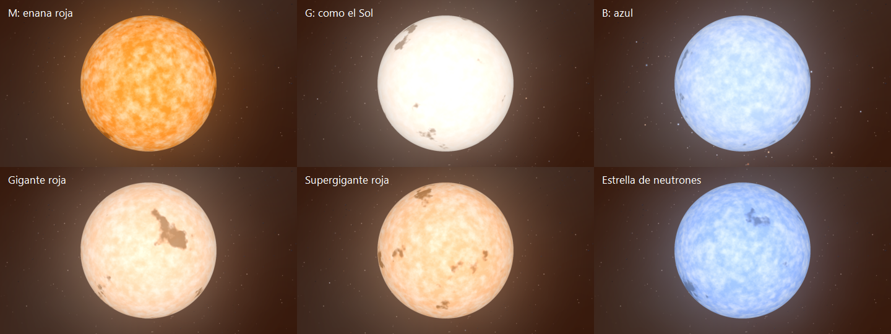

Las seis estrellas ocupan lo mismo en la imagen porque la cámara está a 2,4 radios de cada una. A escala real, la supergigante es más de 10 000 000 de veces más grande que la de neutrones.

### Varias estrellas

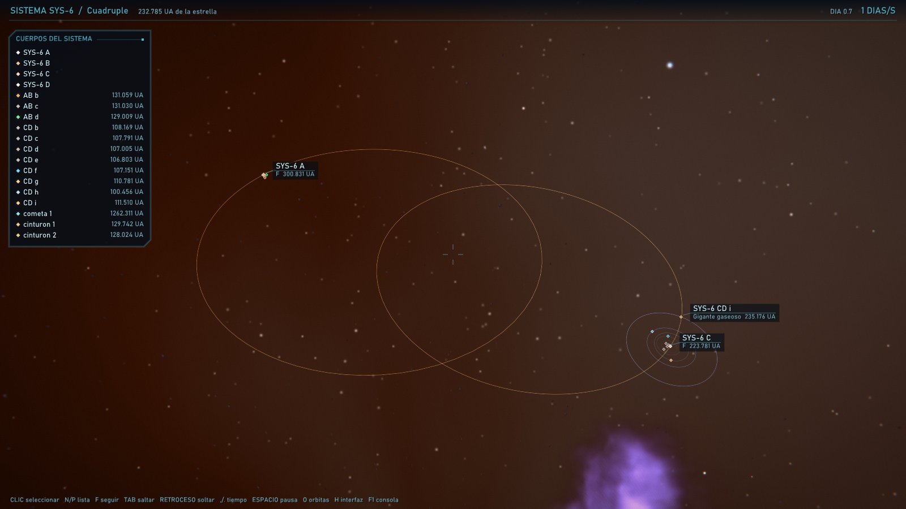

Un sistema puede tener de una a cuatro estrellas. Se guardan como un árbol: una hoja es una estrella y un nodo con dos hijos es su baricentro. Así, una doble, una triple y una cuádruple son la misma estructura, y cada estrella sigue siendo una elipse de Kepler.

| Forma | Planetas | Ejemplo en la galaxia |
|---|---|---|
| Binaria cerrada | Rodean a las dos: `SYS-3 AB b` | `ir binaria`, sistema 3 |
| Binaria abierta | Cada estrella tiene los suyos: `SYS-4 A b`, `SYS-4 B b` | `ir abierta`, sistema 4 |
| Triple | Una pareja cerrada con planetas, y una tercera lejana con los suyos | `ir triple`, sistema 5 |
| Cuádruple | Dos parejas cerradas, cada una con planetas | `ir cuadruple`, sistema 6 |

La probabilidad depende de la clase: un 45 % de las estrellas tipo G tienen compañera, y un 90 % de las O. El sistema 0 siempre es una estrella sola. `GalaxyOptions::maxStars = 1` apaga las múltiples.

Un planeta recibe la luz de sus dos estrellas más importantes, con dos líneas de sombra y el color de cada una. Las mallas, los asteroides incluidos, solo reciben una. La luz de la segunda se suaviza con una raíz cuadrada: con el flujo real, una enana roja junto a una estrella G no se notaría. Mientras dos estrellas no se separen un píxel en pantalla, sus órbitas no se calculan.

### Órbitas según planetas y estrellas

- **Más planetas, más juntos.** El paso entre órbitas sale del espacio disponible y del número de planetas. En una estrella tipo G pasa de 3,2 veces con 3 planetas a 1,9 veces con 12.
- **Más planetas, más circulares y planas.** La excentricidad mediana baja de 0,16 a 0,03 entre esos mismos dos casos.
- **Las estrellas quitan sitio.** Un planeta solo puede estar en la zona estable: dentro de cierto límite alrededor de una estrella, o fuera de cierto límite alrededor de una pareja. Si no caben todos sin romper la separación de Hill, sobran los últimos.
- **Las parejas se separan lo necesario.** Una estrella lejana no puede estar tan cerca que rompa la pareja interior.
- **Los cinturones también.** Se calculan alrededor de cada anfitrión y se recortan si otra estrella está cerca.

### Órbitas

Cada cuerpo tiene una ecuación que da su posición en cualquier instante. No se calcula paso a paso, así que no acumula error ni se rompe al acelerar el tiempo:

```text
M(t) = M0 + n * t
M = E - e * sin(E)
r(t) = a * (cos(E) - e) * P + b * sin(E) * Q
giro(t) = fase + velocidad * t
```

Parámetros aleatorios: semieje mayor, excentricidad, inclinación, nodo ascendente, argumento del periastro, posición inicial, periodo de giro e inclinación del eje. El generador también aplica estas reglas:

- Tipos de planeta según su temperatura y la línea de hielo.
- Órbitas planetarias separadas y sin cruces.
- Lunas fuera del límite de Roche y dentro de la esfera de Hill.
- Lunas en el plano ecuatorial de su planeta.
- Giro acoplado por marea en lunas y cuerpos cercanos a su estrella.
- Ejes tumbados o retrógrados, como Urano y Venus, de vez en cuando.
- Cometas muy excéntricos.

Las ecuaciones se pueden imprimir con los números de cada cuerpo:

```bash
epsilon_system 42 G
```

```text
Sistema 42 c - Roca
  masa 0.1321 Mtierra, radio 3343 km, 794 K, acoplado por marea
  a = 1.90227e+07 km (0.12716 UA), e = 0.1078, i = 0.46 grados, periodo 16.68 dias
  materiales: hierro 62 %, silicatos 38 %, agua 0.0 %, hielos 0 %, gas 0 %; densidad 5.15 g/cm3
  superficie: 794 K, 0 bar, oceano 0 %, hielo 0 %, oxidos 18 %, azufre 5 %, carbono 0 %
  M(t) = 2.30191936 + 4.359923870e-06 * t   [rad, t en s]
  E - 0.107770 * sin(E) = M(t)
  r(t) = 1.902272e+07 * (1 - 0.107770 * cos(E))   [km, distancia al centro]
  x(t) = -1.897379e+06 * (cos(E) - 0.107770) + -1.881704e+07 * sin(E)
  y(t) = 2.527354e+04 * (cos(E) - 0.107770) + -1.509906e+05 * sin(E)
  z(t) = 1.892784e+07 * (cos(E) - 0.107770) + -1.886071e+06 * sin(E)
  giro(t) = 10.255805 + 6.539885804e-06 * t   [rad], eje (0.0078, -1.0000, 0.0021)
```

Las clases aceptadas son `O B A F G K M RG RSG BSG WD NS`. Hay un sistema completo en [sistema_ejemplo.txt](docs/sistema_ejemplo.txt).

### Materiales

Cada planeta, luna y cometa tiene una composición. Los materiales deciden cómo se ve y delatan dónde se formó:

| Variable | Depende de | Efecto |
|---|---|---|
| Hierro, silicatos | Distancia a la línea de hielo: más hierro cerca de la estrella | Densidad y radio: a igual masa, el hierro encoge el planeta |
| Agua, hielos | Aumentan al alejarse | Un planeta con agua es más grande; cerca de la estrella no hay |
| Hidrógeno y helio | Solo en planetas gigantes | Sin suelo; bandas de nubes |
| Óxidos | Hierro expuesto | Suelo rojo |
| Azufre | Mareas de un planeta gigante cercano | Lunas amarillas, como Ío |
| Carbono | Azar y frío | Suelo oscuro |
| Metano | Planetas exteriores | Gigantes de hielo más azules |
| Presión | Masa y temperatura | Brillo de la atmósfera y temperatura real |
| Océano, hielo, nubes | Agua y temperatura | Nivel del mar, casquetes polares y nubes |
| Giro, masa y radio | Rotación | Achatamiento real del planeta |
| Gravedad | Masa y radio | Altura del relieve |
| Temperatura de un gigante | Distancia | Color de sus nubes: amoníaco, agua, despejado, metales o silicatos |

La forma también cambia: un planeta que gira rápido se dibuja como un elipsoide real, con el radio ecuatorial mayor que el polar. Con los datos de la Tierra, Júpiter y Saturno, la fórmula queda dentro del 25 % de su achatamiento real.

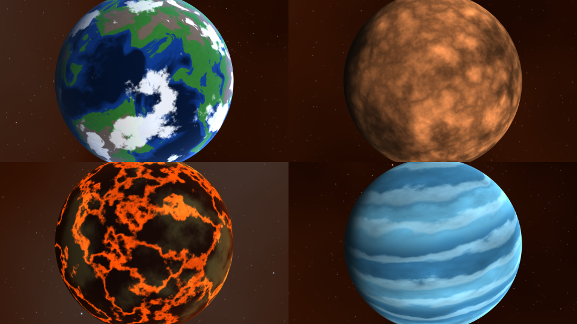

Las fórmulas están en [astrofisica.md](docs/astrofisica.md#materiales).

## Cargar solo lo que se ve

Un sistema no necesita existir hasta que alguien se acerca. Su semilla lo regenera idéntico, y la ecuación de Kepler da la posición de cada cuerpo en cualquier instante sin haberlo simulado mientras no estaba. Esto funciona en dos niveles:

| Nivel | Cuándo | Qué se ahorra |
|---|---|---|
| Sistema | Se crea a 14 veces su tamaño y se destruye a 18; la diferencia evita repetirlo en el borde | Nodos, órbitas, objetos y superficies. Solo queda la estrella |
| Luna | Si toda su órbita ocupa menos de un píxel, no se calcula ni se dibuja | La ecuación de Kepler y el sprite. Vuelve al superar 1 píxel, en su sitio exacto |
| Rocas | Una familia de asteroides no genera sus rocas hasta estar a 6000 km | Su lista completa, que se olvida al alejarse |
| Polvo | El anillo no se calcula si ocupa menos de 8 píxeles de ancho | Todo el cinturón |

Lo seleccionado, lo seguido y el planeta de la estación no se descargan. Los índices de lo que sigue cargado no cambian nunca, porque los huecos se reutilizan.

Resultado de `epsilon_demo streaming 5000`, con la cámara dentro de un sistema:

| Modo | Tiempo por paso | Órbitas calculadas | Objetos vivos | Memoria medida |
|---|---:|---:|---:|---:|
| Todo en memoria | 4,18 ms | 36 498 | 46 498 | 35,1 MB |
| Todo, con lunas ocultas | 4,25 ms | 24 379 | 46 498 | 35,1 MB |
| Bajo demanda y lunas ocultas | 1,38 ms | 10 | 10 017 | 3,3 MB |

El paso es 3 veces más rápido y ocupa 10 veces menos. El tiempo no baja más porque quedan las 5000 estrellas, que sí se ven. Ocultar lunas sin descargar sistemas no mejoró el tiempo: al calcular 12 000 órbitas menos se ahorra menos de lo que varía la medida. Lo que cuenta es descargar el sistema entero. La memoria medida solo cuenta cuerpos, órbitas y nodos.

## Del tornillo al año luz

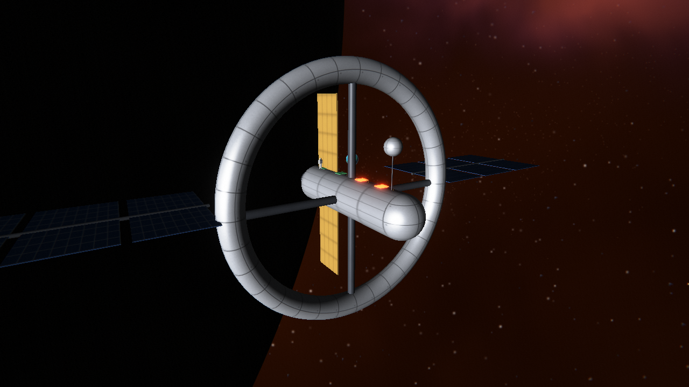

Un tornillo y un planeta aparecen en el mismo fotograma, y se ocultan bien entre sí. Tres decisiones lo permiten:

| Problema | Solución |
|---|---|
| Un depth buffer no da para 5 cm y 50 años luz | Z invertida con `D32_FLOAT`: el plano cercano baja a 5 cm sin perder nada lejos. No hacen falta dos cámaras ni dos pasadas |
| Una posición en km con `double` salta 60 m a 50 años luz | Origen flotante: el mundo se desplaza para que la cámara siga cerca de cero. Las posiciones absolutas se guardan aparte, así que no acumula error |
| Incluso así, cerca de Neptuno salta 1 mm | `LocalSpace`: una burbuja en metros. El visitante y los modelos se miden entre sí, y no importa dónde esté la burbuja |

Dentro de la burbuja todo son metros:

```cpp
LocalSpace& estacion = engine.CreateLocalSpace(nodoDelPlaneta, nodoDeLaEstrella);
const auto id = estacion.Spawn(modelo, {0.0, 0.0, 2.0});

estacion.hasViewer = true;      // la cámara entra en la burbuja
estacion.viewer = {0, 0, -3};   // a 3 m
camara.SetPosition(estacion.ToWorldKm(mundo.scene, estacion.viewer));

const RayHit hit = estacion.Raycast(estacion.viewer, direccion, 8.0);
estacion.SetPartVisible(id, "panel_roto", false);
estacion.SetPartVisible(id, "panel_nuevo", true);
```

| Modelo | Cómo se crea |
|---|---|
| 3D desde archivo | `LoadObj` o `LoadGltf`, y `BuildModel`. Admite `.obj`, `.gltf` y `.glb`, con su jerarquía de nodos y color |
| Animación glTF | `LoadGltfAnimation` muestrea una animación (traslación, giro, escala; lineal, escalón o spline) y da, por cada parte de `LoadGltf`, cuánto se mueve respecto a su reposo (`PartMotion`). `ModelAnimation::Pose(t)` interpola entre muestras. La usa la estación origami del juego para desplegarse |
| 3D por código | `MakeBox`, `MakeCylinder`, `MakeTorus`, `MakeSphere` y `AppendMesh` |
| 2D | `MakeSpritePart`: un cuadro en metros que siempre mira a la cámara, con silueta recortada por el alfa de la imagen |
| Asteroide | `MakeAsteroid(semilla)`: una roca con cráteres, distinta en cada semilla |

Un modelo se divide en partes con nombre. El juego puede ocultarlas, cambiarles el color y apuntarles: con `collision`, el rayo prueba sus triángulos reales. [DemoStation.h](demo/DemoStation.h) construye así la estación de la imagen, con 8 × 26 m de paneles solares y una persona de 1,8 m. Con `--eva` y las teclas J y R se reparan sus cuatro paneles.

Una malla importada aún no recibe sombras ni usa mapas de normales o materiales PBR. Las texturas incrustadas en un `.glb` no se cargan; solo las de archivos aparte, y el juego debe subirlas.

## Asteroides

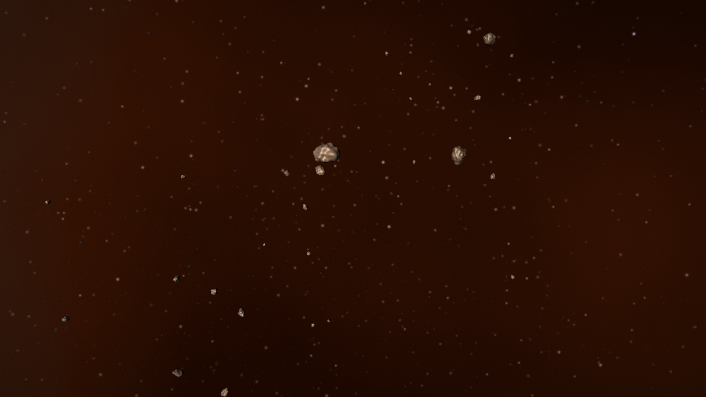

Cada sistema con hueco entre planetas recibe un cinturón, y uno exterior más allá del último planeta. Un cinturón real tiene las rocas separadas del orden de un millón de kilómetros, así que no se vería nada. Por eso se divide en tres niveles, todos con la ecuación de Kepler:

| Nivel | Cuántos | Qué es |
|---|---:|---|
| Polvo | 3000 puntos | Dibuja el anillo visto de lejos |
| Familias | 1200 por cinturón | Cúmulos que siguen una órbita, como las familias de Hirayama reales |
| Rocas | 800 por familia | Solo existen cerca: malla si superan 2,5 píxeles y punto si no |

Las familias son más densas que un cinturón real, porque son un lugar donde jugar. `MakeField` crea un campo fijo sin órbita, para escenarios, y `MakeAsteroid` genera la malla de una roca. El tipo depende de la distancia: dominan los de silicato por dentro y los de carbono más allá de la línea de hielo.

### Campos distintos

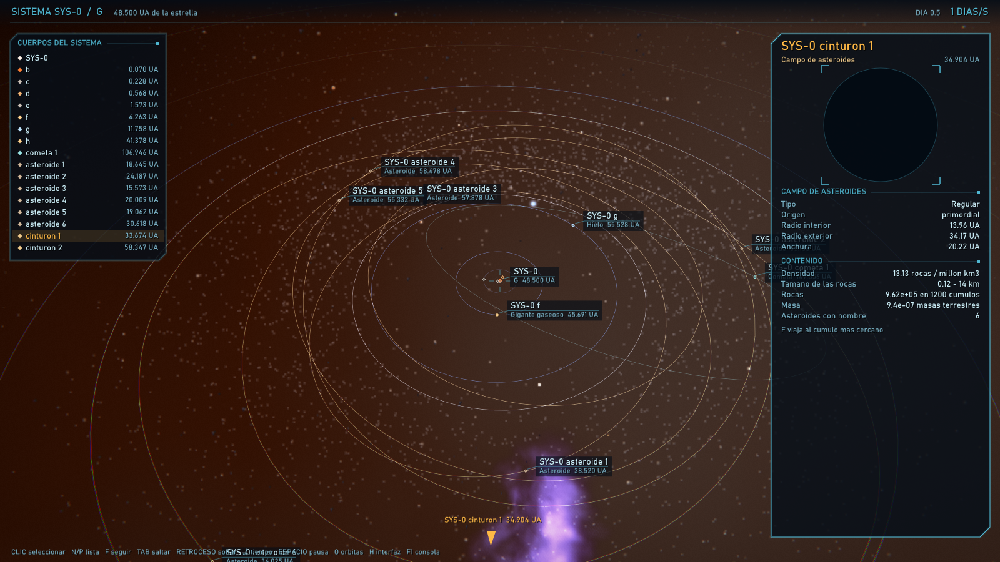

Cada cinturón recibe un perfil. Cambia cuántas rocas tiene, lo juntas que están y de qué tamaño son:

| Perfil | Rocas por millón de km³ | Tamaño de las rocas | Asteroides con nombre |
|---|---:|---|---:|
| Disperso | 3 | 0,2–8 km | 2–4 |
| Regular | 13 | 0,12–14 km | 3–6 |
| Denso | 77 | 0,1–10 km | 5–9 |
| Escombros | 154 | 0,03–2,5 km | 1–3 |
| Gigantes | 0,9 | 2–90 km | 6–10 |

Dentro de un mismo cinturón, cada cúmulo varía entre un 40 % y un 160 % de la media. `MakeField` también acepta tamaños propios.

### Verlos y seleccionarlos

Hay tres niveles de selección, y todos usan la misma ficha, el clic, la lista y la tecla F:

| Qué | Cómo aparece | Qué muestra |
|---|---|---|
| **Campo** | Anillos que marcan sus bordes y una etiqueta en el punto más cercano a la cámara. Está en la lista del sistema | Perfil, anchura, densidad, tamaños, número de rocas y masa. F viaja al cúmulo más cercano |
| **Asteroide con nombre** | Es un cuerpo normal, con órbita, ficha y malla irregular. Se listan al seleccionar su campo | Lo mismo que un planeta, con su órbita dibujada |
| **Roca del campo** | Se apunta de cerca y se hace clic: pasa a ser un cuerpo mientras está seleccionada | Radio, materiales y órbita de su cúmulo |

Una roca no ocupa memoria hasta que se genera su cúmulo, y al soltarla vuelve a ser solo una posición. `PickRock` y `PromoteRock` son la misma vía para el juego.

## Choques y explosiones

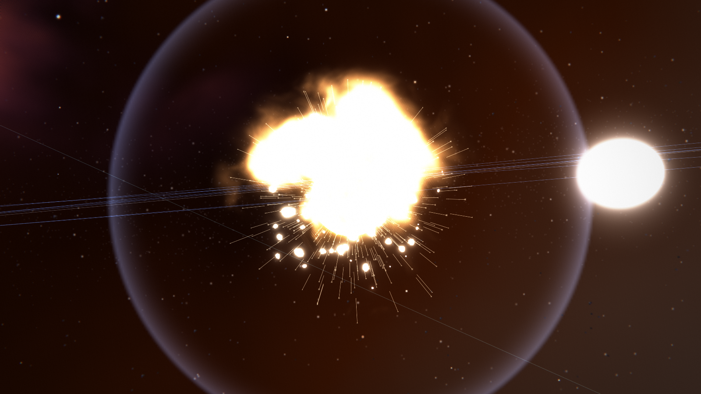

Como las órbitas son funciones del tiempo, un choque es un instante que se puede calcular de antemano. Hay cuatro maneras de que ocurra:

| Origen | Cómo funciona |
|---|---|
| **Programado** | `Collisions().Schedule(atacante, objetivo, ahora)` resuelve el problema de Lambert. El atacante cambia de órbita sin saltar y llega a la hora exacta |
| **Generado** | Con `galaxy.impacts`, el sistema 7 trae un asteroide que golpea a su mayor planeta el día `impactDay`. `ir inestable` lleva allí |
| **Detectado** | Cada paso se comparan cometas y asteroides con los planetas cuyas órbitas pueden tocarse |
| **Rocas de un campo** | Dos rocas a la vista se lanzan una contra otra. Con `colision.rocas` ocurre solo |

Desde la consola:

```text
chocar c b            # el planeta c contra el b
chocar asteroide g 90 # el asteroide más cercano a g, en 90 días
chocar seleccion e    # lo seleccionado contra e
chocar rocas          # dos rocas del campo donde estás
```

El resultado sale de la energía del choque comparada con la que dispersa el objetivo:

| Resultado | Cuándo | Qué queda |
|---|---|---|
| Cráter | El proyectil pesa menos del 2 % y queda más del 90 % de la masa | El cuerpo, con una marca incandescente que se enfría y un cráter permanente |
| Fusión | Dos cuerpos grandes y queda más del 90 % | Un solo cuerpo mayor, con la superficie fundida |
| Rotura parcial | Queda del 10 % al 90 % | Un resto menor y fundido, y un campo de escombros |
| Destrucción total | Queda menos del 10 % | El cuerpo se agrieta y desaparece con sus lunas. Queda un campo de escombros en su órbita |
| Absorbido | Contra una estrella o un agujero negro | Solo un fogonazo |

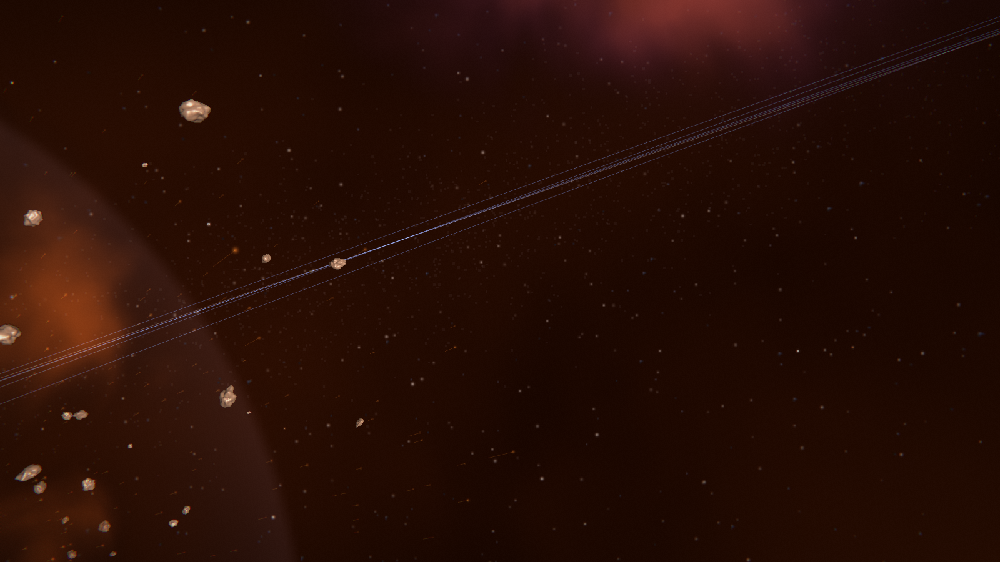

La explosión reutiliza piezas del motor: un destello que alimenta el bloom, una onda de choque, una nube que usa el trazado volumétrico de las nebulosas y fragmentos con la malla de los asteroides, incandescentes al principio. Dura 16 segundos reales aunque el tiempo simulado vaya a un día por segundo: **es una representación, no una simulación de fluidos.** `epsilon_window` baja el tiempo a 60 s/s al ocurrir un choque en el sistema donde estás y, si estabas siguiendo al objetivo, lleva la cámara al lado del golpe.

Lo que un choque cambia queda en `SystemHistory`, aparte de la semilla. Al descargar y recargar el sistema, lo destruido sigue destruido, el cráter sigue ahí y el campo de escombros continúa en su sitio. Un choque generado que debía ocurrir con el sistema descargado se resuelve al cargarlo, sin explosión. Los cambios de órbita de `Schedule` no se guardan: por eso los cuerpos implicados no se descargan hasta el impacto.

## Agujeros negros

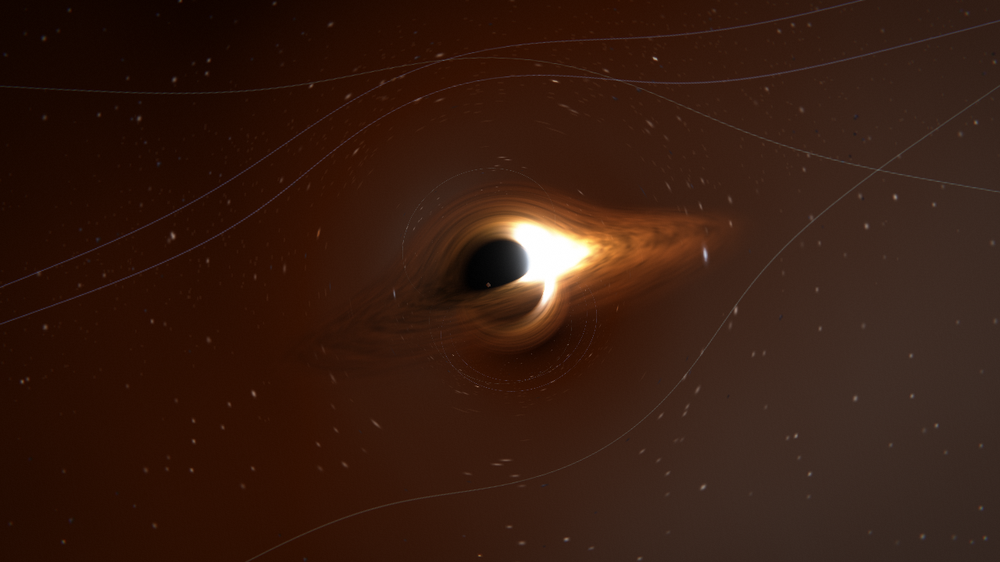

El juego original solo tenía un tipo, así que hay dos formas físicas y la masa es libre: la misma fórmula sirve para uno estelar y para uno supermasivo.

| Forma | Rota | Sombra | Última órbita estable |
|---|---|---|---:|
| Schwarzschild | No | Círculo exacto | 3 rs |
| Kerr | Sí | Se aplana y se desplaza hacia el lado que gira | 1,16 rs con a/M = 0,9 |

Con `--focus schwarzschild`, `--focus kerr` o `--focus supermassive` se viaja a uno. La galaxia garantiza uno de cada forma y un supermasivo de 4,3 millones de soles, como Sagitario A*, en el centro de la nebulosa. De lejos son un sprite, y al acercarse los sustituye la lente.

Cada píxel sigue la trayectoria curva de un rayo de luz. Por eso la parte trasera del disco aparece encima y debajo de la sombra, y las estrellas y las órbitas se deforman. El lado que se acerca brilla más por efecto Doppler.

| Comprobación | Motor | Valor exacto |
|---|---:|---:|
| Radio de la sombra de Schwarzschild | 2,564 rs | 2,598 rs |
| Desviación de la luz a 30 rs | 0,0701 rad | 0,0699 rad |
| Anchura de la sombra de Kerr, a/M = 0,9 | 4,77 rs | 4,84 rs |
| Desplazamiento de la sombra de Kerr, a/M = 0,9 | 0,60 rs | 1,00 rs |

**Schwarzschild es físicamente fiel. Kerr es una aproximación:** acierta la anchura, pero el desplazamiento se queda en un 60 % del real. Una geodésica de Kerr exacta por píxel sería mucho más cara. Por encima de a/M = 0,9, el efecto del giro se limita para que el método no pierda estabilidad.

## Nebulosas y shaders

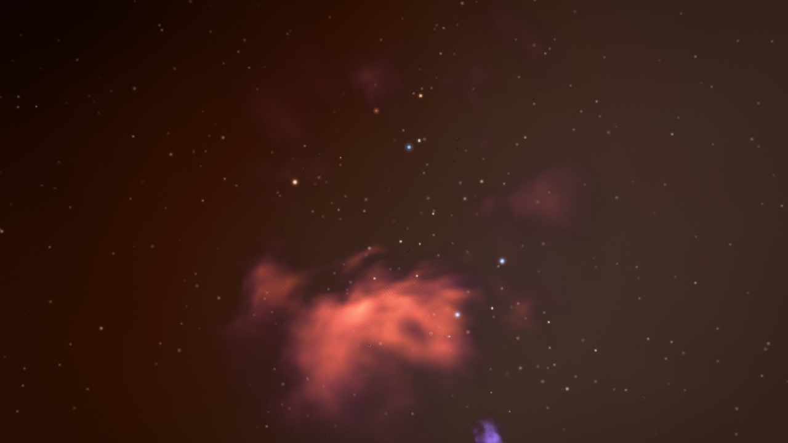

Las nubes de la nebulosa son volumétricas, y se atraviesan con la cámara. Un rayo por píxel avanza 26 pasos, suma luz y resta transparencia sobre un ruido 3D de 64³ que se repite sin costuras. Corre a media resolución, porque una nube no tiene bordes nítidos. Respetan la profundidad, así que un planeta tapa lo que tiene detrás y la nube tapa al planeta que queda dentro. Hasta 4 nubes a la vez. `config.galaxy.nebulae` indica cuántas hay.

La imagen se calcula en HDR, con 16 bits por canal, y estas etapas se añaden al final:

| Efecto | Comando | Qué hace |
|---|---|---|
| Bloom | `bloom` | Lo que supera 1 brilla alrededor, con 5 niveles de reducción |
| Curva de tono | Siempre | Comprime solo lo que se pasa de brillo: los planetas se ven como antes |
| Viñeta | `vineta` | Oscurece las esquinas |
| Aberración | `aberracion` | Separa los colores hacia los bordes, como una lente |
| Grano | `grano` | Ruido suave, que disimula las bandas de color |
| Propio del juego | `efecto cabina on` | Ejemplo con `AddPostEffect`: líneas de pantalla de cabina |

## Interfaz

La interfaz se activa y se desactiva con H. Cambia según dónde esté la cámara:

| Lugar | Qué muestra |
|---|---|
| Fuera de un sistema | Solo estrellas: nombre, clase y distancia, y una lista de las 10 más cercanas |
| Dentro de un sistema | Estrella, planetas y cometas, con lista de sus cuerpos ordenada por órbita |
| Cerca de un planeta | También sus lunas |

Dentro de un sistema significa a menos de 2,5 veces el tamaño de sus órbitas planetarias.

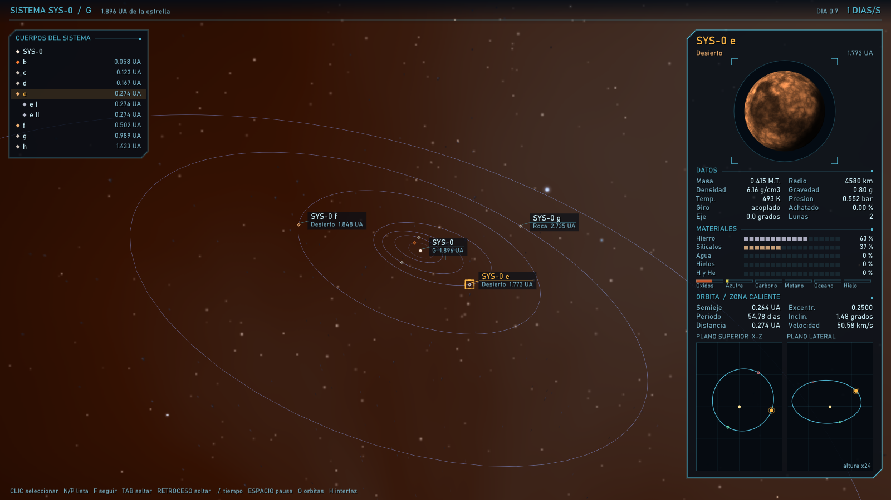

Apunta con la mira y haz clic para seleccionar, o recorre la lista con N y P. Al seleccionar un cuerpo aparece su ficha:

- **Miniatura 3D:** es la misma esfera por píxel del motor, con sus materiales, su eje y su giro. Su giro se limita para que no parpadee al acelerar el tiempo.
- **Órbita en dos planos:** vista superior y lateral, con el periastro en verde, el apoastro en rojo y la posición actual en ámbar. La altura lateral se exagera, y el panel indica cuánto.
- **Datos:** masa, radio, densidad, gravedad, temperatura, presión, giro y achatamiento.
- **Materiales:** barras de composición y muestras de lo que colorea la superficie.
- **Zona:** caliente, habitable, fría o más allá de la línea de hielo.

Una estrella muestra su sistema en lugar de una órbita: las órbitas desde arriba y un corte con la zona habitable y la línea de hielo. Si el cuerpo seleccionado queda fuera de la pantalla, una flecha indica hacia dónde está.

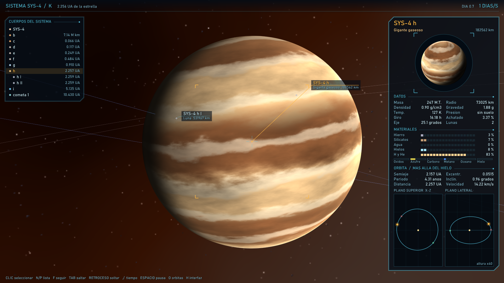

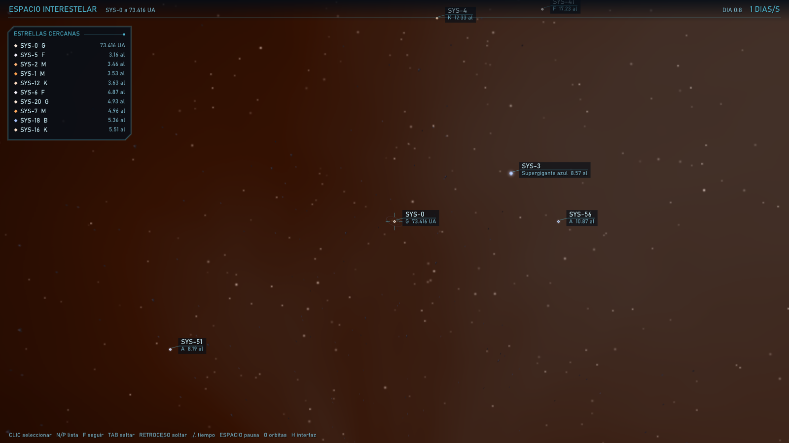

Usa [Dear ImGui](https://github.com/ocornut/imgui) 1.93 como lienzo y para dibujar texto, instalado por vcpkg. La alternativa era RmlUi, con estilo parecido a HTML y CSS, pero necesita más integración con SDL_GPU, y ImGui ya trae soporte para esa API. La fuente es Bahnschrift, incluida en Windows 10 y 11. Si no existe, usa Segoe UI, Consolas o la fuente de ImGui.

La simulación entrega un `HudFrame` junto a cada `FramePacket`, así que el hilo de dibujo no lee posiciones que otro hilo está cambiando.

### Ver objetos diminutos en un espacio enorme

A escala real, un planeta visto desde otra órbita ocupa menos de un píxel. Tres ayudas lo resuelven sin falsear las posiciones:

- Las órbitas se dibujan como líneas si ocupan al menos 6 píxeles, y pasan exactamente por el cuerpo.
- Cada planeta conserva un punto mínimo, que se apaga entre 300 y 600 veces el tamaño de su órbita. Sin esto, los planetas de otros sistemas se amontonarían sobre su estrella.
- Las estrellas lejanas son más grandes en pantalla cuanto más luminosas son.

### Modelos generados

[generar_modelos.py](tools/generar_modelos.py) crea 96 modelos: 3 por clase de estrella y 6 por tipo de planeta. Cada uno tiene un sprite y su paleta en `catalogo.tsv`. El juego elige para cada cuerpo el modelo de su tipo con el color más parecido al de sus materiales.

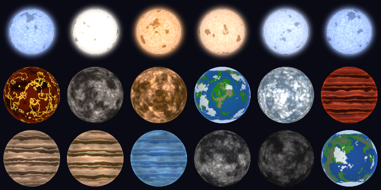

```bash
python tools/generar_modelos.py --variantes 12 --tam 256 --semilla 7
```

Sustituye a `astro_gen_v2.py` en este motor, que no se modificó. Solo usa la biblioteca estándar, porque este equipo no tiene numpy, Pillow ni `perlin_noise`. Los sprites no llevan sombra pintada, ya que de lejos la luz puede llegar desde cualquier lado. Tu arte original sigue en la mezcla.

De cerca, el color no sale del catálogo: planetas y lunas usan sus materiales, y las estrellas su temperatura real.
### Cómo se simula la tercera dimensión

Tus sprites tienen la luz y la sombra pintadas, y una imagen plana no puede girar. Por eso cada cuerpo cercano es una esfera calculada por píxel en [sphere.hlsl](engine/shaders/sphere.hlsl), sin malla:

1. El vertex shader coloca un cuadro que cubre la silueta de la esfera.
2. Cada píxel lanza un rayo y calcula dónde toca la esfera. Eso da la normal real.
3. Esa normal se gira con la rotación del cuerpo, y con ella se calcula el ruido 3D de la superficie.
4. La luz se calcula con la dirección real hacia su estrella.
5. El píxel escribe su profundidad real, así que los cuerpos se tapan correctamente.

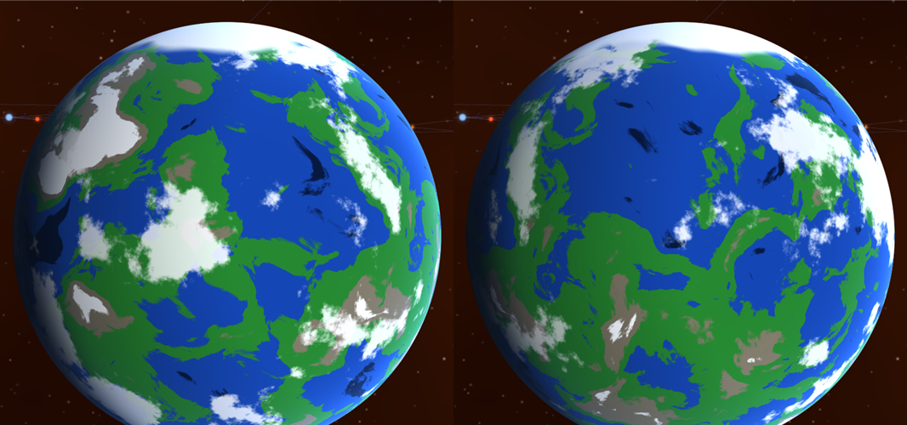

La imagen compara el mismo planeta en dos instantes. Los continentes cambian porque la superficie existe en 3D y gira.

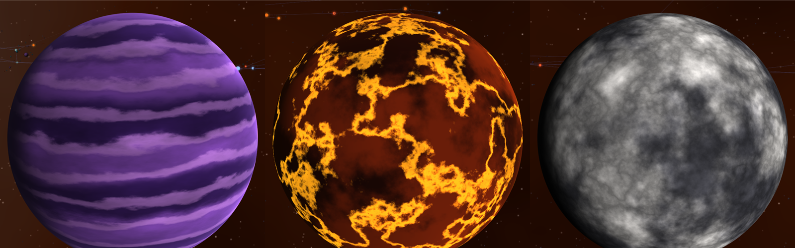

El shader incluye cinco tipos: terrestre, gaseoso, lava, roca y estrella. Sus colores salen de `SurfaceLook`, y `seed` hace que cada cuerpo sea distinto.

### Detalle según la distancia

| Medida | Efecto |
|---|---|
| Sprite lejano | Por debajo de 6 píxeles de radio se dibuja tu arte, sin cálculo por píxel |
| Capas de ruido | Van de 1 a 10 según los píxeles disponibles: lejos la superficie es difusa |
| Sprites reducidos | Se cargan a 64 píxeles, porque nunca se ven más grandes |
| Mipmaps | Los sprites usan un nivel más difuso con `mip_lod_bias` |

Medido a 1600×900 en la RX 6600, sin sincronización vertical y con Release, en una sola pasada de cada escena:

| Escena | Sprites + esferas | FPS | Texturas en GPU |
|---|---|---:|---:|
| Vista general, con detalle por distancia | 25 + 0 | 804 | 12,9 MB |
| Vista general, sin detalle por distancia | 8 + 65 | 670 | 32,1 MB |
| Planeta a 1,05 radios | 25 + 1 | 217 | 12,9 MB |
| Estrella a 1,1 radios | 21 + 1 | 208 | 12,9 MB |

La interfaz añade unos 0,2 ms por fotograma: la vista general pasó de 760 a 654 FPS con ella, y a 634 con la ficha abierta.

El detalle por distancia ahorra 19,2 MB de texturas, un 60 %. En esta vista general también dio un 20 % más de FPS, aunque esa cifra es menos fiable que la de memoria. El coste real depende de los píxeles cubiertos, así que el peor caso es estar pegado a una superficie. A mayor resolución costará más.

El panorama de fondo sigue a resolución completa y ocupa buena parte de la memoria restante.
## Librerías recomendadas

| Función | Allegro 5 | Recomendación | Licencia |
|---|---|---|---|
| Ventana, eventos, entrada | `al_create_display`, colas de eventos | **SDL3** (3.4.20 al 5-nov-2026) | zlib |
| Gráficos | `al_draw_*` | **SDL_GPU**, sobre Direct3D 12 o Vulkan | zlib |
| Imágenes | `al_load_bitmap` | `SDL_LoadPNG`, incluido en SDL 3.4; **SDL3_image** solo para JPG u otros formatos | zlib |
| Interfaz | Dibujo a mano | **Dear ImGui** 1.93, ya integrada | MIT |
| Modelos 3D | No tiene | **cgltf**, ya integrada para glTF; OBJ con lector propio | MIT |
| Fuentes | `al_load_font` | ImGui las dibuja en la interfaz; **SDL3_ttf** si no la usas | zlib |
| Audio | `al_play_sample` | **SDL3_mixer** (requiere SDL 3.4.0 o posterior) | zlib |
| Tareas en paralelo | No tiene | `JobSystem` propio; **enkiTS** si crece el proyecto | zlib |
| Matemáticas | Fórmulas a mano | `Math3D.h` propio; **GLM** 1.0.3 si se necesita más | MIT |

SDL3 es la opción más cercana a Allegro porque reúne ventana, entrada, audio y gráficos con el mismo estilo de API en C. El compilador de shaders `dxc.exe` ya está instalado con el Windows SDK de este equipo.

### Alternativas descartadas

| Librería | Ventaja | Por qué no es la primera opción |
|---|---|---|
| **bgfx** | Muchos backends; BSD-2 | Solo resuelve el dibujado y requiere integrar su propio sistema de compilación |
| **Diligent Engine** | Grabación multihilo de comandos; Apache 2.0 | Es más grande de lo que necesita este juego |
| **raylib** | La más sencilla de aprender | Su modelo de dibujado inmediato no ayuda con el multihilo |
| **Direct3D 12 directo** | Control total | Exige gestionar memoria y sincronización a mano |

### Regla de hilos en SDL_GPU

Un command buffer solo puede usarse en el hilo que lo adquirió y debería enviarse desde ese mismo hilo. La textura del swapchain, además, debe adquirirse en el hilo que creó la ventana. Se pueden grabar varios command buffers en paralelo si se envían en el orden correcto.

Por eso el hilo principal atiende eventos y GPU, y la simulación corre en otro hilo. Este juego dibuja pocos objetos, así que la grabación en paralelo no hace falta por ahora.

### Vistas de buffers en Direct3D 12

SDL_GPU 3.4.20 crea vistas RAW sin stride para los storage buffers en Direct3D 12. Con `StructuredBuffer`, la RX 6600 de este equipo leyó datos incorrectos y casi nada aparecía en pantalla. Los shaders usan `ByteAddressBuffer` y calculan cada elemento a mano.

## De 2D a transformaciones 3D

El juego calculaba cada punto con senos y cosenos, y después lo dibujaba como bitmap 2D. El motor expresa lo mismo como un producto de matrices:

```text
clip = Proyección × RotaciónVista × (Mundo − PosiciónCámara)
NDC  = clip.xyz / clip.w
```

Una rotación o escala es lineal. La traslación es afín, por eso se usan coordenadas homogéneas.

| Juego original | Motor |
|---|---|
| `CalcularProyeccion` | `Camera::WorldToScreen`, `Camera::Projection` |
| `proyectar3D` del mapa táctico | `TacticalMapMatrix` |
| `fov` | `focalPx`; con `ancho / 2` da 90° horizontales |
| `escala` limitada a 1–100 | `PixelSize`, tamaño real con mínimo y máximo |
| `NodoCuerpoCeleste::orbitas` | `SceneGraph` y `KeplerOrbit` |
| `sistemaApuntado` | `PickNearestToCenter` |
| `ParticulaEstrella` en 2D | `SkyStar`, direcciones reales sobre una esfera |
| `DibujarVista3D` | `FrameBuilder` y un `IRenderBackend` |

En GPU, cada sprite es un cuadro instanciado orientado a la cámara, cada esfera se calcula por píxel y el fondo es un panorama equirectangular que rota en 3D. CMake compila los shaders a DXIL con `dxc`.

Otras decisiones:

- **Cámara relativa:** las posiciones se guardan en `double` y se restan antes de pasar a `float`. Así la GPU nunca recibe números enormes.
- **Z invertida con plano lejano infinito:** reparte mejor la precisión de profundidad en escenas espaciales. El depth buffer usa `D32_FLOAT`, se limpia a 0 y compara con `GREATER_OR_EQUAL`. Esferas y mallas lo escriben, y sprites y líneas solo lo consultan. El plano cercano es de 5 cm.
- **Cuaterniones:** evitan el bloqueo de cardán y preparan el vuelo libre en seis grados de libertad.

## Arquitectura multihilo

```text
Hilo de simulación (120 Hz)                Hilo principal
---------------------------                --------------
UpdateOrbits      ┐                        Eventos de SDL
UpdateWorld       ├─ JobSystem (N núcleos) AcquireLatest()
FrameBuilder      ┘                        SdlGpuBackend::Render
        │                                        ▲
        └──── TripleBuffer<FramePacket> ─────────┘
```

- `FramePacket` es una copia sin punteros al mundo, así que el render nunca lee datos que la simulación está cambiando.
- `TripleBuffer` entrega siempre el fotograma más reciente, sin bloqueos.
- El resultado es idéntico con 1 o con N hilos: las pruebas lo comprueban.

## Resultados verificados

En la RX 6600, `epsilon_window` presentó todos sus fotogramas en Release y en Debug, en cada escena: sistema, los dos agujeros negros, supermasivo, asteroides, nebulosa y estación. Las ejecuciones usaron cámara automática o teclas simuladas y no mostraron errores de SDL.

Rendimiento a 1600×900 sin sincronización vertical, en Release:

| Escena | FPS |
|---|---:|
| Sistema con interfaz | 348–377 |
| Binaria cerrada con interfaz | 260–275 |
| Campo de asteroides | 405–462 |
| Campo con choques continuos entre rocas | 358–455 |
| Planeta explotando a pantalla casi completa | 232–464 |

Son tres medidas por escena. Varían mucho entre sí porque otra ventana del motor seguía abierta, y la de la explosión depende del instante que cae dentro de la medida. No se comparan con la tabla anterior, medida con otra galaxia:

| Escena, medición anterior | FPS |
|---|---:|
| Sistema con interfaz | 394 |
| Igual, sin bloom, viñeta, aberración ni grano | 466 |
| Igual, sin asteroides ni nube visible | 605 |
| Dentro de una nebulosa | 638 |
| Campo de asteroides | 654 |
| Estación con interfaz | 439 |
| Agujero negro a 30 rs | 311 |
| Agujero negro a 8 rs, a pantalla completa | 256 |

El vuelo hacia delante, Shift, el seguimiento con Tab, el choque con una estrella, la selección con clic, la carga y descarga al alejarse y la reparación con el rayo se probaron con entradas simuladas. El proyecto externo instalado con `find_package`, y los dos módulos por separado, compilaron y funcionaron. Las explosiones, los dos soles, los campos y la roca seleccionada con clic se probaron con cámara y clic simulados. La capa de depuración corrió con el binario Release sobre explosión, cuádruple y estación, y el vuelo fuera de una cuádruple produjo cargas y descargas reales. Sin verificar todavía: ratón y teclado reales, la consola con F1 escrita a mano, las teclas J y R, cambio de tamaño con la ventana abierta, fuga de memoria en sesiones largas y un `.glb` real exportado desde Blender. glTF se probó con un archivo mínimo escrito por la prueba, y OBJ con uno pequeño. La opción `--debug` no confirma que la capa de depuración estuviera activa, porque el programa continúa sin ella si no está instalada.

El aspecto de los shaders y de los modelos se comprobó mirando capturas, no con pruebas automáticas.

Núcleo compilado con MSVC 19.51 en Debug, Release y AddressSanitizer, y SDL en Debug y Release. Más de 365 000 comprobaciones sin fallos; el total varía un poco entre ejecuciones porque algunas pruebas de hilos dependen del reparto. Las pruebas incluyen:

| Prueba | Qué garantiza |
|---|---|
| Ecuación de Kepler resuelta con e hasta 0,99 | Error menor que 10⁻¹¹ |
| Integración numérica RK4 de una órbita con e = 0,6 | Coincide con la fórmula, con error menor que 10⁻⁵ del semieje |
| Energía y momento angular | Constantes durante 400 muestras |
| Tercera ley contra los ocho planetas de la NASA | Margen del 1,5 % |
| 18 000 sistemas, 1500 por clase de estrella | Sin cruces, a 10 radios de Hill y lunas estables |
| Tierra, Marte, Urano | Temperatura, radio de Hill y radios conocidos |
| Achatamiento de la Tierra, Júpiter y Saturno | Margen del 25 % respecto a la NASA |
| 400 sistemas con materiales | Las fracciones suman 1, y hay más hierro cerca de la estrella |
| Modelo de la interfaz | Fuera solo hay estrellas, dentro solo su sistema, y clic, lista y flecha funcionan |
| Sistema descargado y recargado años después | Mismos cuerpos, en el sitio exacto que da la ecuación, y sin dejar basura tras 40 ciclos |
| Origen flotante | Nada cambia respecto a la cámara |
| Modelos a 50 años luz del origen | Un desplazamiento de 3 mm sobrevive |
| Volumen de cada malla generada | Tamaño correcto y triángulos hacia fuera |
| Sombra y desviación de la luz | Comparadas con las soluciones exactas de la relatividad general |
| Comandos | Apagar una función elimina su trabajo; los errores no cambian nada |
| 1560 sistemas múltiples, de todas las clases y formas | Sin contacto, jerarquía estable, planetas dentro de su zona y centro de masas fijo |
| Zonas estables | Pareja igual, y Kepler-16 |
| Órbitas según N | Con 12 planetas, paso y excentricidad menores que con 3 |
| Perfiles de cinturón | Densidad y tamaños en su rango, y determinismo |
| Campo, asteroide y roca seleccionados | Lista, ficha, posición exacta y sin fugas al soltarlos |
| Órbita desde posición y velocidad | Ida y vuelta en 3000 órbitas, también planas y circulares |
| Problema de Lambert | Llega al punto pedido y con la velocidad prevista |
| Choque programado, generado y detectado | Hora exacta, el atacante no salta y el resultado no depende de que el sistema estuviera cargado |
| Choque y recarga | Lo destruido no vuelve; el cráter y los escombros se conservan |
| Mismo resultado con 1 o N hilos, y con la misma semilla | Determinismo |

También se mantienen las 9766 proyecciones aleatorias comparadas con una copia de `CalcularProyeccion`. La comparación usa tolerancias, así que confirma equivalencia dentro de esos márgenes, no igualdad bit a bit.
Rendimiento de `epsilon_demo bench 300000`, con Xeon E5-2680 v4. Son 572 mil objetos y 552 mil órbitas elípticas, de los que unos 14 mil quedan visibles. No se comparan con cifras anteriores: la escena es distinta, y resolver la ecuación de Kepler cuesta más que una órbita circular.

| Hilos | Tiempo por fotograma | Aceleración |
|---:|---:|---:|
| 1 | 205,2 ms | 1,00× |
| 2 | 102,6 ms | 2,00× |
| 4 | 52,4 ms | 3,92× |
| 8 | 32,1 ms | 6,40× |
| 16 | 26,2 ms | 7,83× |
| 28 | 25,8 ms | 7,96× |

La aceleración es mejor que antes porque casi todo el tiempo está en las órbitas, que se reparten bien entre núcleos. Se estanca cerca de 16 hilos; este equipo tiene 14 núcleos físicos, y no se midió cada etapa por separado. Con unos cientos de objetos, el trabajo cabe en un solo tramo y se ejecuta en serie, lo cual es correcto para esa carga.
## Problemas del juego original

Conviene corregirlos al migrar. Los archivos originales no se modificaron.

| Ubicación | Problema | Solución |
|---|---|---|
| `CLMAPA.cpp:80` | `random_shuffle` ya no existe en C++17 | Usar generador y mezcla propios |
| `CLMAPA.cpp`, `main.cpp:105` | Las partidas regeneran la galaxia con `rand()`; al cambiar de compilador puede cambiar el resultado | Usar `std::mt19937` y una mezcla propia; las partidas viejas podrían no ser compatibles |
| `GRAFICOS.cpp:240-241` | Yaw y pitch tienen signo contrario al del fondo (`:195-201`) y al de los enemigos (`:428`), así que los sistemas se mueven en sentido opuesto | `SetYawPitchRoll` usa el signo correcto; `SetLegacyAngles` conserva el original |
| `GRAFICOS.cpp:338, :349-372` | Dibujar modifica el estado del juego | Actualizar en la simulación; sin este cambio no se puede dibujar en otro hilo |
| `GRAFICOS.cpp:173, :225` | `esHeroica` se lee sin inicializar | Eliminado en `SkyStar` |
| `GRAFICOS.cpp:177-178` | Las estrellas de fondo no tienen profundidad real | `GenerateSky` |
| `MENUMANAGER.cpp:1193-1194, :1266` | `al_create_builtin_font()` se llama al dibujar y nunca se libera | Cargar la fuente una sola vez |
| `GRAFICOS.cpp:513, :517`, `main.cpp:414` | `al_rest` congela el bucle principal | Usar animaciones por estado y temporizadores |
| `GRAFICOS.cpp:66` | Llama a Python y espera durante la carga | Generar los recursos antes o en una tarea de fondo |
| `CLMAPA.cpp:83, :128-131` | Las órbitas llegan a unas 4500 unidades y los sistemas están a 100–400 | Tamaños absolutos y órbitas que no se cruzan |
| `CLMAPA.cpp:124-142` | Los planetas se generan, pero nunca se dibujan ni se animan | `SceneGraph` y `KeplerOrbit` |
| `GRAFICOS.h:87`, `CLMAPA.h:27-28` | Hay funciones declaradas sin implementar | Eliminarlas |
| `#include "Globales.h"` | No coincide en mayúsculas con `GLOBALES.h`; solo funciona en sistemas que las ignoran | Unificar los nombres |

`MENUMANAGER.cpp` también contiene una copia antigua comentada en las líneas 1–887.

## Siguientes pasos

1. Migrar el generador de `CLMAPA.cpp` y sus partidas guardadas a `std::mt19937`.
2. Añadir capa 2D para cabina, HUD y menús, con texto mediante SDL3_ttf.
3. Migrar los estados de `main.cpp`: mapa táctico, combate y salto warp.
4. Migrar el audio a SDL3_mixer.
5. Añadir sombras, mapas de normales y materiales PBR a las mallas, y cargar texturas incrustadas de `.glb`.
6. Añadir física cercana: choques de la nave con rocas, gravedad en la estación y agarre de asideros.
7. Añadir anillos, eclipses entre estrellas, colas de cometa y resplandor en primer plano. Hoy el arte de tus soles solo se ve de lejos.
8. Añadir a la interfaz búsqueda por nombre, marcadores y un cursor libre para hacer clic en la lista.
9. Si quieres más realismo orbital: perturbaciones entre planetas y precesión.
10. Generar los sistemas en un hilo de fondo si un juego necesita muchos más.

## Fuentes

- [Versiones de SDL](https://github.com/libsdl-org/SDL/releases/latest)
- [API GPU de SDL3](https://wiki.libsdl.org/SDL3/CategoryGPU)
- [SDL_AcquireGPUCommandBuffer](https://wiki.libsdl.org/SDL3/SDL_AcquireGPUCommandBuffer)
- [Port de SDL3 en vcpkg](https://github.com/microsoft/vcpkg/tree/master/ports/sdl3)
- [SDL_mixer](https://github.com/libsdl-org/SDL_mixer)
- [bgfx](https://github.com/bkaradzic/bgfx)
- [Diligent Engine](https://github.com/DiligentGraphics/DiligentEngine)
- [enkiTS](https://github.com/dougbinks/enkiTS)
- [GLM](https://github.com/g-truc/glm)
- [Dear ImGui](https://github.com/ocornut/imgui)
- [Port de imgui en vcpkg](https://github.com/microsoft/vcpkg/tree/master/ports/imgui)
- [cgltf](https://github.com/jkuhlmann/cgltf)
- Datos astrofísicos: ver [astrofisica.md](docs/astrofisica.md#fuentes)
