# Nebulosa

Una nave enorme atrapada en una nebulosa tan densa que apenas se ve a unos cientos de miles de kilómetros. Hay naves y estaciones alienígenas, hostiles y neutrales, y estructuras abandonadas muy avanzadas repartidas por el mapa.

Las mecánicas funcionan, pero **todas las cifras son provisionales**: las mejoras y las condiciones están por decidir.

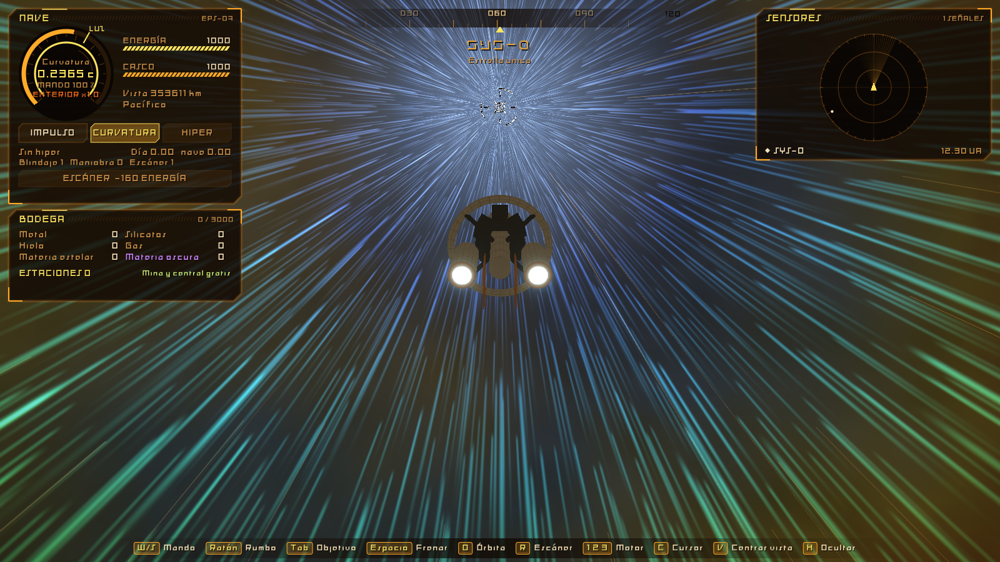

## Compilar y jugar

En Visual Studio, elige la configuración `x64 SDL Release` y el objetivo `epsilon_game.exe`. Si ya está compilado:

```bash
out\build\x64-sdl-release\epsilon_game.exe
```

| Entrada | Acción |
|---|---|
| Ratón, W A S D | Apuntar el rumbo: la nave lo sigue con retraso. W y S cabecean, A y D giñan |
| Q, E | Girar sobre el eje de la nave |
| R, F | Subir o bajar el mando: cuánto empuja el motor. F por debajo de cero da marcha atrás |
| Espacio | Frenar, también en burbuja, y mantener la posición contra la gravedad |
| T o botón central | **Rueda de opciones** |
| M | **Mapa**: sistemas, astros y modelo en 3D |
| G | Disparar al objetivo todo lo que esté listo |
| B | El rumbo sigue la solución de tiro del cañón espinal, hasta volver a pulsar o mover el rumbo |
| K | Cambiar de escudo: arena, plasma, electromagnético y apagado |
| 1, 2 | Impulso, crucero |
| 3, 4 | Híbrida, con el primer emisor de energía negativa; hiper, con el segundo |
| Tab | Siguiente objetivo de los sensores |
| C | **Activar o desactivar el cursor en la interfaz** |
| H | Mostrar u ocultar las teclas |
| Enter | Avanzar el diálogo |
| Botón derecho | Arrastrar la cámara alrededor de la nave, en cualquier sentido |
| Rueda | Acercar o alejar la cámara |
| V | Devolver la cámara detrás de la nave |
| Esc | Pausa |
| F1 | Consola de comandos; escribe `ayuda`. Ctrl+V pega, Ctrl+C copia y Ctrl+X corta |

Las teclas de vuelo también funcionan con el cursor activo; solo el ratón deja de mover el rumbo. Q gira a la izquierda y E a la derecha.

### A pie

| Entrada | Acción |
|---|---|
| W A S D | Andar |
| Ratón | Mirar |
| Mayús | Correr |
| Espacio | Saltar |
| V | Primera o tercera persona |
| E | Volver a la nave, junto a la esclusa |

### Rueda de opciones

T abre la rueda y un clic elige; también se puede mantener el botón central, mover el ratón y soltar. La nave sigue volando, sin mandos, mientras está abierta. Las trece opciones están siempre en el mismo sitio, y lo que no sirve ahora se ve apagado: Escáner, Ir o Parar, Órbita, Atracar o Soltar, A pie, Usar, Mina, Central, Mejorar, Análisis, Mapa, Disparar y **Trayectoria** (o Quitar ruta).

**Trayectoria** dibuja en verde lo que va a recorrer la nave en los próximos 30 segundos reales con el mando y el giro que lleva: una copia de la nave vuela sola, girando hacia donde apuntas y con la gravedad de ahí (junto a una estación, en su marco y con sus topes). Lleva una marca cada 5 segundos y «+30 s» al final.

### Atraque

Cada estación tiene una **escotilla** con luz verde: la mina, en el costado del núcleo, entre dos brazos; la central, encima del depósito, lejos de los colectores. Con una estación propia como objetivo, **Atracar** en la rueda la lleva hasta ella, con la ruta si está lejos. A unos 50 000 km engancha un **haz de atraque** que primero la rodea, sin atravesarla, hasta ponerla delante de la escotilla, y luego la mete en línea recta con la proa por delante: no hay rebotes ni forma de pasarse. Atracada, la proa toca la escotilla y la sigue aunque la estación gire u orbite; se repara el casco y la partida se guarda así. Al dar mando, o con Soltar, sale; recién soltada, esa estación no choca hasta que la nave se aparta.

Sin atracar también se puede arrimar a mano hasta la escotilla. A menos de 3000 km de una estación propia, el tiempo se frena y la velocidad respecto a ella se recorta según la distancia, contada en segundos reales: acercarse va a la distancia entre 12 s y alejarse, entre 6 s. A menos de **25 km** el tiempo corre como el real y mandan los **propulsores finos**: acercarse va a la distancia entre 15 s (20 m/s como poco) y rodearla o alejarse, entre 12 s (120 m/s como poco). La nave cuenta como lo que es, 1,2 km de proa a popa y 400 m de ancho, así que puede pasar junto al casco; rozarlo a esas velocidades apenas abolla. El centro de la pantalla dice en qué zona estás y la velocidad máxima. Sin mando, unos estabilizadores frenan la deriva y la nave se queda al lado.

En esos 3000 km la nave vuela **en el marco de la estación**: la estación la lleva consigo mientras orbita, su planeta o su estrella no tiran de ella y la velocidad que se ve es respecto a la estación. Al soltar amarras se queda donde estaba, y con el mando se mueve a su alrededor sin que la órbita la deje atrás. Una mina en un cinturón va a decenas de km/s con su cúmulo, y antes se quedaba atrás en cada paso (por eso la nave salía despedida); ahora va pegada. Alrededor de una mina en un cúmulo no quedan rocas en 15 km: las ha despejado ella.

### A pie

Atracada, **A pie** en la rueda baja a la cubierta de la estación: un hangar de 60 por 40 m con galería, escalera, columnas y carga. El de una mina tiene cajas de mineral y una cinta, y el de una central el núcleo de antimateria. Hay tres tripulantes que van de un sitio a otro. El tiempo corre a tiempo real, no a 60 veces. La gravedad es artificial, de 1 g. Se vuelve con E junto a la esclusa, la puerta azul.

Las personas usan un motor propio, [Humanoid.h](../engine/include/epsilon/Humanoid.h), en metros y con Y hacia arriba, dentro de un recinto que el juego coloca en el mundo. Así sus centímetros no se pierden aunque estén a muchas unidades astronómicas del origen. El cuerpo mide 1,8 m por 0,6, anda a 1,6 m/s, corre a 4,5, salta medio metro, sube solo escalones de 40 cm y no atraviesa nada. Con gravedad 0 flota, para cuando haga falta salir al vacío. La cubierta es una lista de cajas, [OnFoot.h](include/game/OnFoot.h): las mismas sirven para chocar y para dibujarse, así lo que se ve es lo que se pisa.

### Consola

Cada comando deja su respuesta en el registro de la pantalla. Pegar varias líneas las ejecuta una a una; la última, sin salto de línea, queda escrita para revisarla y confirmar con Enter.

## Menú de inicio

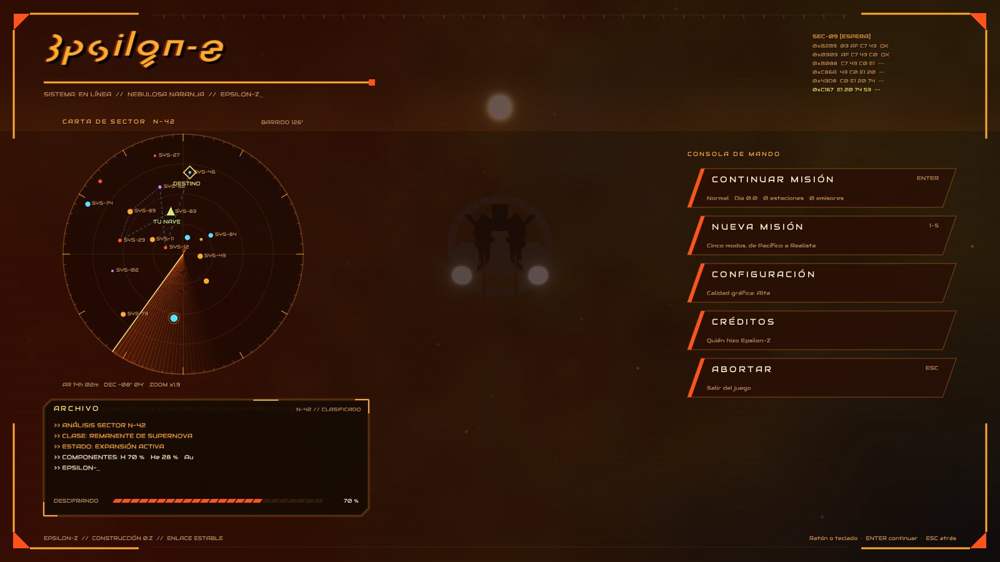

Una consola de navegación con la misma estructura que la de Epsilon 0: el nombre arriba a la izquierda y los botones a la derecha, dentro del marco holográfico de esquinas. Alrededor hay una carta de sector con barrido de radar y la ruta hacia un destino, el archivo del sector N-42 que se descifra línea a línea y una columna de códigos que corre. Es decoración: no revela nada de la partida.

| Botón | Qué hace |
|---|---|
| Continuar misión | Sigue la partida guardada. También con Enter |
| Nueva misión | Elige uno de los cinco modos. También con las teclas 1 a 5 |
| Configuración | Calidad gráfica, pantalla completa y sincronización vertical |
| Créditos | Quién hizo el juego y de quién son las letras |
| Abortar | Sale del juego. También con Esc |

Esc vuelve atrás desde cualquier página. La configuración también se abre desde la pausa.

### Calidad gráfica

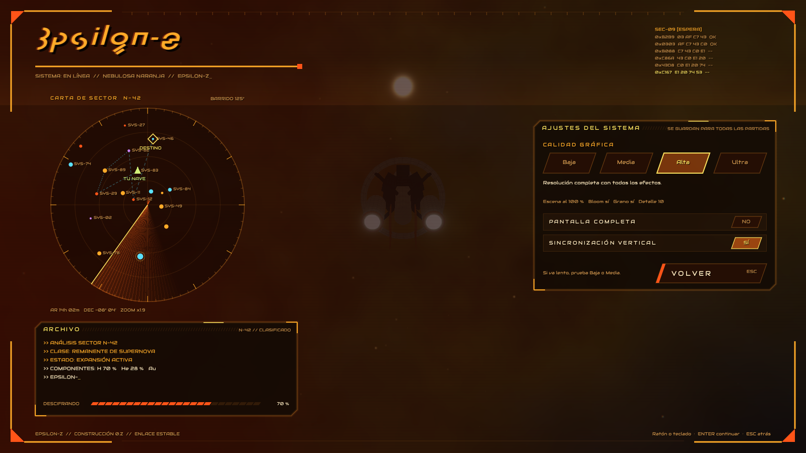

| Calidad | Escena | Bloom | Grano y aberración | Detalle de superficies | Casco dañado |
|---|---:|---|---|---:|---|
| Baja | 50 % | No | No | 5 capas | No se ve (las piezas perdidas sí desaparecen) |
| Media | 75 % | Sí | No | 7 capas | Quemaduras |
| Alta | 100 % | Sí | Sí | 10 capas | Quemaduras y grietas al rojo |
| Ultra | 100 % | Sí | Sí | 12 capas, más nítidas | Además, daño en 3D: cráteres hundidos que perforan, vigas y chapas que asoman, escombros, chispas y gas |

Lo que más alivia a una tarjeta modesta es la escena: en Baja se pinta a la mitad de resolución, la cuarta parte de los píxeles, y luego se amplía. La interfaz va siempre a resolución completa, así que el texto sigue nítido. La configuración se guarda en `%APPDATA%\Epsilon\Nebulosa\ajustes.txt` y vale para todas las partidas. Los perfiles están en [Settings.cpp](src/Settings.cpp).

## Modos de juego

| Modo | Daño | Al perder la nave |
|---|---:|---|
| Pacífico | Ninguno | Nada te ataca |
| Fácil | ×0,5 | Vuelves al punto de control sin perder carga |
| Normal | ×1 | Vuelves y pierdes un cuarto de la bodega |
| Difícil | ×1,6 | Vuelves y pierdes la mitad de la bodega |
| Realista | ×1,6 | Lo pierdes todo y empiezas de cero |

Se guarda un punto de control al desplegar una estación, al recoger de ella y al vaciar una estructura. Los emisores de energía negativa recuperados no se pierden en ningún modo salvo en Realista.

### Partidas guardadas

La partida se guarda sola en cada punto de control, al localizar algo con el escáner y al salir. También hay un botón en la pausa. El menú ofrece seguir la partida guardada; una partida nueva la sustituye al llegar al primer punto de control. En Realista, perder la nave borra el archivo.

El archivo está en `%APPDATA%\Epsilon\Nebulosa\partida.sav`. Es texto, una línea por dato, con el nombre del dato delante:

- Se puede abrir y leer, y una versión nueva del juego puede añadir líneas sin romper las antiguas.
- Los números vuelven exactamente iguales al cargar.
- La última línea es una suma de control: un archivo cortado o tocado a mano se rechaza en lugar de cargarse a medias, así que editarlo a mano no sirve.
- Se escribe en un archivo temporal y luego sustituye al bueno. Un corte de luz al guardar no destruye la partida anterior.
- Una partida de antes de la versión 4 sigue valiendo: la materia oscura de la bodega se descarta, y haberla encontrado cuenta como el primer emisor de energía negativa.
- Una de antes de la versión 5 se carga con los escudos y refrigerantes de serie, llenos, y la nave fría; los alienígenas reciben su escudo al cargar.

Si hubiera que ocultar los datos, bastaría con cambiar [SaveGame.cpp](src/SaveGame.cpp): el resto del juego no conoce el formato.

Cuando el casco llega a cero, la nave se desmantela: las piezas se sueltan, estallan a lo largo del casco y cede el reactor.

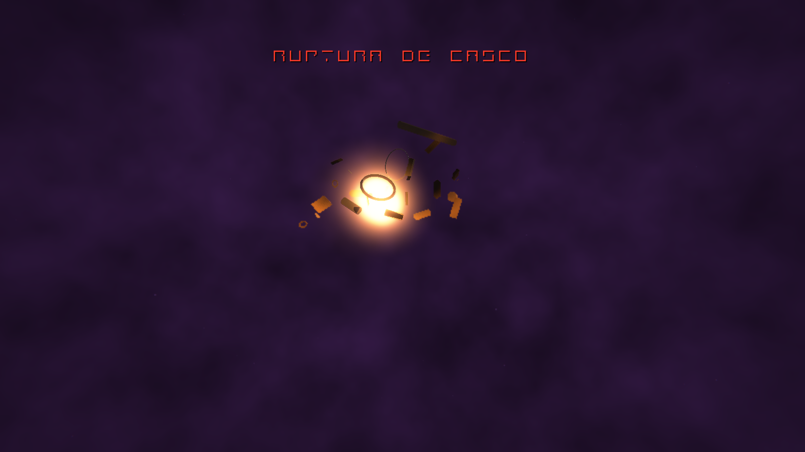

## Unidades

Las cifras son unidades reales: la energía va de **petajulios a yottajulios** (PJ, EJ, ZJ, YJ) y la potencia de **gigavatios a exavatios** (GW, TW, PW, EW); la masa, en **toneladas, kilotoneladas y megatoneladas** (t, kt, Mt). Las conversiones están en [Units.h](include/game/Units.h).

La nave guarda 1 ZJ de energía, 120 kt de antimateria y 3 Mt de carga. Una central junto a una estrella como el Sol capta unos 750 EW, dos millonésimas de su luz: un enjambre de espejos de unos 28 000 km de lado a esa distancia. Una mina da unas decenas de kt por hora.

## Mecánicas

### La nebulosa

La niebla oculta lo opaco según la distancia, y su espesor cambia de una zona a otra. Va del rojo al gris pasando por el naranja y el amarillo: el color cambia por zonas al viajar y también de un lado a otro del cielo.

Los planetas con atmósfera muestran aire iluminado sobre el borde, del color de su aire. Se apaga hacia el espacio y en el lado de noche, y su grueso cambia de un punto a otro y con el tiempo.

Las estrellas dispersan su luz en la niebla, con un brillo suave que no depende de que estén en pantalla, así que nada salta al girar la cámara. De lejos son un resplandor. Su radiación barre la niebla alrededor, y de cerca se ve la superficie: granos de plasma, filamentos, manchas y zonas activas, con la corona sobre el borde del disco.

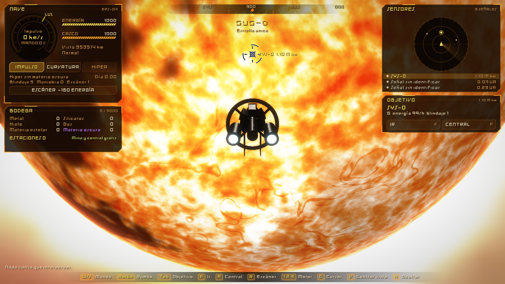

### Luz sobre la nave

Lejos de todo, la niebla reparte una luz suave de su mismo color. Cerca de una estrella o de un agujero negro manda una sola fuente: el lado iluminado brilla y las sombras son casi negras. Un planeta cercano devuelve la luz con su propio color, igual que una segunda estrella. Vale para la nave, las estaciones y los alienígenas. Lo que no se ve aparece en los sensores: primero como una señal sin identificar y, al acercarse, con su nombre y su actitud.

### Manejo y física

Es una nave de 1,2 km y se maneja como tal. El ratón apunta adónde quieres ir, y el casco gira despacio hacia allí, frenando para no pasarse. Un giro de 57° tarda unos 6 segundos. El nivel de maniobra mejora el giro, el derrape y el empuje; `maniobra 3` lo prueba.

- **Empuje e inercia.** El mando no pide una velocidad: dice cuánto empuja el motor. Al soltarlo la nave sigue por inercia, y la nebulosa la frena poco a poco, a la mitad en cerca de un minuto real.
- **Frenar.** Espacio frena con los propulsores y luego mantiene la nave quieta contra la gravedad. Al empezar está así. En curvatura, la burbuja cae en menos de un segundo.
- **Marcha atrás.** Con F por debajo de cero el motor empuja hacia atrás, a la mitad de fuerza. Sale con el motor normal, también en burbuja.
- **Gravedad.** Lo que no tiene empuje cae. Cada cuerpo domina una zona a su alrededor (su esfera de influencia), y dentro de ella la nave vuela respecto a él: una nave quieta junto a un planeta viaja con el planeta, y un cúmulo de asteroides la lleva con él. Ya no hay que perseguir nada.
- **Órbitas.** Si llevas la velocidad adecuada, orbitas de verdad, sin motor. Órbita, en la rueda, circulariza la órbita a la altura actual, gastando energía. Una órbita así no decae ni gasta, y el barrido funciona en ella. Cerca de un planeta la niebla no frena; alrededor de una estrella, una órbita libre sí decae.
- **Curvatura.** Dentro de la burbuja no hay gravedad ni fricción. La burbuja se suma a la velocidad que llevabas, y al apagarla esa velocidad sigue ahí.

En el espacio no hay arriba ni abajo: la nave y la cámara pueden dar la vuelta completa en cualquier eje. Lo apuntado no se adelanta más de unos 37° al casco, para que no se salga de la pantalla. La cinta de rumbo sigue siendo una referencia del plano del sistema; el radar va en los ejes de la nave, con delante al fondo.

El punto de mira se dibuja con el color inverso de lo que tiene detrás, así que se ve sobre una estrella igual que sobre el vacío. Si el rumbo o lo apuntado se salen de la pantalla, o quedan detrás de la cámara, su marca se queda en el borde como una flecha hacia donde están, y la línea entre los dos sigue dibujada. En el centro de la pantalla hay además un **anillo de giro** fijo: la flecha amarilla dice hacia dónde gira la proa ahora mismo (más larga cuanto más deprisa, con los grados por segundo), el triángulo hueco verde hacia dónde va a girar (lo apuntado), y el arco violeta de fuera, hacia dónde rueda. La línea azul es la trayectoria que sigues por inercia o en órbita; la amarilla, la ruta y su órbita de llegada. Sus puntos se aprietan junto a la nave, donde está la cámara, y se separan a lo lejos: así la curva se ve suave sin dibujar miles de tramos.

### Ruta asistida

Con un objetivo, Ir, en la rueda, calcula y vuela la ruta: orienta la nave, viaja en crucero, forma una burbuja si va a otra estrella y hay antimateria para ello, frena y la deja en órbita circular, o junto a una estación. Rodea lo que se cruce, a 1,15 radios de un planeta y a 4 de una estrella, y reduce para poder trazar la curva. El lateral muestra la fase, la distancia y el tiempo que queda. Llegar a una mina al otro lado de un planeta lleva unos 20 segundos.

La ruta no corre cerca de una masa: su velocidad depende de lo lejos que esté de cualquier cuerpo, y frena con margen para no pasarse nunca. Se probaron 18 rutas por tres galaxias, sin un rasguño.

### Choques y calor

- Contra un planeta, una luna o un asteroide por encima de **1 km/s**, la nave **se hace añicos**. Por debajo, abolla el casco según el cuadrado de la velocidad.
- Las **naves, bastiones, estructuras y estaciones propias también son sólidos**, con las mismas reglas de velocidad. Embestir una nave o un bastión le hace el mismo daño que recibe tu casco, y lo vuelve hostil. Atracando, la estación deja pasar a la nave. Con las estaciones propias cuenta la eslora entera de la nave, de proa a popa, y la esfera real de la estación (0,32 km la mina, 0,45 km la central).
- Las **rocas sueltas del anillo** también son sólidas (ver Cinturones).
- Tocar una estrella la **vaporiza**. Dentro de **4 radios**, el calor quema el casco con la cuarta potencia de la distancia, y a 1,5 radios la evapora en unos segundos; cada nivel de blindaje de más acorta esa zona. La órbita de trabajo de una estación está mucho más lejos, a 8 radios.
- Un paso largo no se salta nada: se comprueba todo el tramo recorrido, también en curvatura.
- Hasta 30 segundos antes salta la alarma de colisión o de calor letal.
- En modo Pacífico nada de esto destruye la nave: resbala por la superficie.

### Casco por zonas

El casco tiene 15 zonas, cada una con su integridad: proa, puente, las seis bodegas, anillo de curvatura, góndolas y radiadores de babor y estribor, espina y núcleo ([HullZones.h](include/game/HullZones.h)). El panel **Estructura**, abajo a la derecha, las enseña vistas desde arriba: verde entera, amarilla tocada, roja a punto de caer, gris perdida; parpadea la que acaba de recibir.

- **Un proyectil da donde lo lleva su trayectoria.** Su tramo recorrido, visto desde la nave (que también se mueve), se sigue a través de las formas de las zonas, y la primera que toca recibe el golpe (`ProjectileImpact`). Un disparo de frente apuntado a una góndola da en la góndola, no en la proa. Uno que va al núcleo por estribor da antes en la góndola de estribor, y uno que pasa por el hueco del anillo sigue hasta lo que haya detrás. Si pasa rozando o estalla por proximidad, cuenta la zona más cercana a su paso. El cráter de Ultra se abre en ese mismo punto, sobre la superficie real del modelo.
- Los choques y las rocas, que no tienen trayectoria propia, caen en la zona del lado que da al cuerpo: casi siempre la más cercana, a veces una vecina. Una zona aguanta de lleno el **30 %** del casco entero.
- El daño sin dirección (calor de una estrella, presión de ariete, sobrecalentamiento) se reparte entre todas.
- Una zona periférica que llega a 0 **se suelta**: sale despedida a unas decenas de m/s, girando, al rojo los primeros segundos, y se pierde. Pasa igual en todas las calidades.
- **El daño avanza hacia dentro.** Lo que sobra de un golpe, y todo lo que entra por el hueco de una zona ya perdida, pasa (al 70 %) a la zona de detrás: proa → puente → espina → núcleo; bodegas y anillo → espina; góndolas y radiadores → núcleo.
- En una central, o atracada en cualquier estación propia, las zonas se reparan al ritmo del casco. Una pieza perdida **solo se rehace atracada**. Una zona reparada del todo pierde sus cráteres.
- Las zonas se guardan con la partida; una partida anterior empieza con el casco entero. Los cráteres no se guardan.

**Lo que hace cada zona.** Dañada, su sistema rinde menos; perdida, deja de existir:

| Zona | Sistema | Efecto |
|---|---|---|
| Góndolas | Empuje | Cada una da la mitad: con una se acelera la mitad; sin ninguna quedan los propulsores de maniobra (8 %) |
| Anillo de curvatura | Crucero, híbrida e hiper | Dañado llega menos lejos y tarda más en formar la burbuja; por debajo del 25 % no hay curvatura, solo impulso |
| Radiadores | Refrigeración | Rotos, sueltan menos calor (un 25 % sin ninguno) |
| Proa | Conos ablativos | Las placas van en ella: dañada caben menos; sin proa, ninguna |
| Bodegas | Carga | Al perder una se pierde su parte de cada material |
| Puente | Puntería | La torreta falla más cuanto peor está (hasta 4 veces) |
| Espina | Maniobra | Gira y acelera peor (hasta el 40 %) |
| Núcleo | Reactor | Saca menos energía de la antimateria (hasta el 25 %) |

**Zonas rojas.** El puente, la espina y el núcleo no se sueltan: si llegan a 0, la nave está perdida aunque le quede casco. Un golpe directo en una zona roja hace **1,5 veces** más daño.

- **Puente** a 0: la nave se queda sin mando y **se apaga**.
- **Espina** a 0: la energía ya no llega a ningún sistema y **se apaga**.
- **Núcleo** a 0: pierde la contención y **estalla** («FALLO DE CONTENCIÓN»).

Al apagarse empieza una cinemática de 14 s: franjas negras, la alarma con la zona que ha caído, las luces de la nave parpadean y mueren, la nave se queda a la deriva girando despacio, y un parte se escribe letra a letra (sin mando, sin potencia, escudos caídos, soporte vital) hasta la baliza de socorro, que destella en rojo sin que nadie responda. La cámara se aparta despacio y todo acaba en negro, con la pantalla final «NAVE APAGADA». En creativo y en Pacífico nada apaga la nave.

**Cómo se ve, según la calidad.** El daño lo dibuja el propio shader de mallas ([mesh.hlsl](../engine/shaders/mesh.hlsl)). En Baja la instancia no lleva daño y el shader se lo salta, así que no cuesta nada. En Media, manchas de quemadura que crecen con el daño. En Alta, además grietas y bordes al rojo que se enfrían en unos segundos. Las luces de una zona dañada se apagan.

**En Ultra, el daño es 3D.** Solo con esta calidad se calcula; en las demás ni se mira. Cada golpe que llega al casco sin que lo paren los escudos queda anotado (`GameSession::HullHits`):

- Un rayo lo clava en la superficie real del modelo, desde el lado por el que llegó. Vale igual para la maqueta que para un `.glb`.
- Abre un **cráter** de 10 m a ~120 m según la parte del casco que se lleve. Los vértices se hunden y el borde se levanta, y la normal sigue la pendiente para que la luz lo marque. Alrededor queda una quemadura en rayos con brasas. Si el golpe es fuerte (más de ~2,5 % del casco) **perfora**: el agujero tiene el labio fundido, y dentro se ve el interior a oscuras con el resplandor del metal. Los choques abollan más ancho y no perforan.
- Del cráter **asoman vigas en I** dobladas y **chapas arrancadas** abiertas como pétalos, al rojo al principio.
- El golpe **arroja escombros**: astillas, chapas, trozos de viga y roca, que salen despedidos girando y se quedan atrás. También salta una lluvia de **chispas**, y por un agujero escapa un chorro de **gas**.
- Cada pieza lleva hasta cuatro cráteres, los más grandes. Se recuerdan los últimos 48 golpes.

Para que la abolladura se vea, las caras grandes de la nave se parten hasta que ninguna arista pase de 12 m (`SubdivideLongEdges`).

### Tu nave en glTF

El juego carga la nave de `modelos/nave.glb` (o `.gltf`), junto al ejecutable, o del archivo que se le pase con `--nave archivo.glb`. Si no hay ninguno, o no se puede leer, usa la maqueta hecha por código y lo avisa en la consola. La nave del juego está en [assets/modelos](assets/modelos), y la compilación la copia junto al ejecutable. Su archivo de Blender y sus notas están en [../assets/modelos/nave_epsilon](../assets/modelos/nave_epsilon/LEEME.md).

- **Escala y ejes:** 1 unidad = 1 m. +Y hacia arriba y la proa hacia −Z. En Blender: proa hacia +Y, arriba +Z, y la escala aplicada. El origen debe quedar a media eslora, sobre el eje.
- **Las medidas salen del modelo:** las zonas toman la forma de sus piezas (`BuildZoneLayout`: bolas de unos 30 m que las cubren), así que un proyectil da en la pieza que de verdad está en su camino. La eslora y el ancho para los choques, la cámara y el panel **Estructura**, que dibuja la planta de cada pieza, también salen de él.
- **Una pieza por zona:** cada nodo con malla es una pieza. Si se separa la nave en piezas, cada una se daña, se apaga y se suelta por su cuenta. Una nave de una sola malla también se abolla y se agujerea, pero no puede perder piezas.
- **El nombre del nodo dice su zona:** `proa`, `puente`, `bodega_1` a `bodega_6`, `anillo`, `gondola_babor`, `gondola_estribor`, `radiador_babor`, `radiador_estribor`, `espina` y `nucleo`. También vale en inglés (`bow`, `bridge`, `hold`, `ring`, `nacelle`, `engine`, `radiator`, `spine`, `core`). Sin un nombre conocido, la pieza va a la zona que tenga más cerca. Sin «babor» ni «estribor», el lado se saca de la posición.
  - Se mira por orden: `nucleo`, `puente` o `ventanas`, `proa`, `anillo` o `brazo`, `gondola`, `tobera`, `escape` o `motor`, `radiador`, `espina` y `bodega`. Cuenta la primera palabra que aparezca: `radiador_brazo` iría al anillo, y `espina_ventanas`, al puente.
  - En `bodega_N` cuenta el número más bajo del 1 al 6 que haya en el nombre: no conviene poner otras cifras.
  - Con varias piezas por zona basta con empezar el nombre por la zona: `bodega_3_blindaje`, `gondola_babor_tobera`, `nucleo_motor_principal`.
- **Anillos que giran:** una pieza cuyo nombre empieza por `rotor1_`, `rotor2_`… gira alrededor del eje de la nave. Los impares giran en un sentido y los pares en el otro, a la velocidad que da 1 g en la cara interior del anillo. Un anillo dañado gira más despacio, uno suelto sigue girando por inercia y, con la nave apagada, se van parando. Los cráteres giran con su anillo.
- **Color, textura y brillo:** se usa el color base del material. Una textura en un archivo aparte se carga; una incrustada en el `.glb` todavía no. La emisión del material, con su intensidad (`KHR_materials_emissive_strength`, que Blender exporta solo), da el brillo propio de la pieza (luces y ventanas), y se apaga con el daño de su zona como el de la maqueta.

### Módulos

La nave se arma por módulos ([ShipModules.h](include/game/ShipModules.h)). Todo se cambia en el **Taller** (rueda > Taller, o `taller` en la consola), atracada en una estación propia. Montar cuesta metal y silicato de la bodega, y lo que se quita devuelve la mitad. En creativo el taller abre en cualquier sitio y no cuesta nada.

- **Ranuras exteriores:** son los nodos vacíos `hp_…` del `.glb` (la nave trae `hp_torreta_1` a `hp_torreta_6`); la maqueta tiene seis en el puente y el núcleo. Lo que se monta en ellas **se ve** sobre el casco, apuntando hacia fuera:

  | Módulo | Efecto | Coste |
  |---|---|---|
  | Torreta | Un arma más, con su recarga, que dispara desde su ranura | 260 metal + 60 silicato |
  | Aleta de radiador | +25 % de refrigeración | 180 + 40 |
  | Antena de sensores | +30 % de alcance del escáner | 150 + 90 |
  | Placa de blindaje | Su zona aguanta un 40 % más | 320 |

- **Bahías interiores:** no se ven. Hay dos por bodega, tres en la espina, dos en el núcleo, una en el puente y una en la proa:

  | Módulo | Efecto | Coste |
  |---|---|---|
  | Almacén | +1 Mt de bodega | 200 + 20 |
  | Tanque de antimateria | +40 kt de antimateria | 240 + 120 |
  | Refuerzo estructural | Su zona aguanta un 30 % más | 280 + 30 |

- **Motor de impulso:** una sección que se cambia entera. Cada modelo sube la velocidad máxima y la aceleración del impulso, gasta más energía y cambia el color del escape:

  | Motor | Velocidad | Aceleración | Gasto | Coste (menos la mitad del montado) |
  |---|---|---|---|---|
  | Iónico de serie | x1 | x1 | x1 | — |
  | Iónico de alto flujo | x1,5 | x1,3 | x1,4 | 400 + 120 |
  | Plasma pulsado | x2,2 | x1,7 | x2 | 900 + 300 |
  | Fusión magnética | x3 | x2,2 | x3 | 1800 + 700 |

- **La bodega depende de las bodegas:** cada una de las seis aporta un sexto de la capacidad de serie; si se pierde, esa parte también.
- **Un módulo se pierde con su sitio:** si cae su zona o, en las exteriores, se arranca la pieza en la que va montado.
- **Daño pieza a pieza:** cada pieza del modelo tiene su propia integridad. Un impacto con trayectoria daña la pieza más cercana de su zona, medida sobre puntos de su superficie real. Lo pequeño (una antena, un escape, un mástil) se rompe antes que la zona entera. A 0 **se arranca sola** y se aleja girando, aunque su zona aguante. Las piezas se reparan con la zona, y una arrancada solo se rehace atracada.
- **Mejoras visibles:** las mejoras de siempre añaden piezas al casco, posadas con un rayo sobre la superficie real. Cada nivel de escáner añade una antena en la espina, cada nivel de computador una cúpula en el puente, cada nivel de maniobra cuatro propulsores a los lados de la proa y del núcleo, y cada nivel de blindaje un escudo térmico abombado en la punta de la proa.
- Módulos, motor e integridad de las piezas se guardan con la partida. Las torretas de los módulos salen de los módulos al cargar.

### Tiempo

El jugador vive el tiempo de a bordo. Fuera pasa más deprisa, y los mundos, las estaciones y los alienígenas van a ese ritmo. El reloj de velocidad muestra `EXTERIOR x` cuando se nota, y el panel da el día exterior y el de la nave.

- **Velocidad.** Es el factor de Lorentz real: a 0,99 c, fuera pasan 7 veces más. Por eso cruzar un sistema lleva segundos a bordo.
- **Gravedad.** La fórmula es la real, `1 / sqrt(1 - rs / r)`, y junto a un agujero negro se usa tal cual. Junto a una estrella el efecto real sería de millonésimas, así que allí se multiplica por 100 000 para que se note: **ese número es decisión de juego**, en [Balance.h](include/game/Balance.h). Junto a un planeta sigue siendo casi nulo.
- Por encima de la luz no hay fórmula, así que el tiempo exterior va al máximo, 60 veces. Cruzar 0,1 años luz a 10 c lleva 3,6 días fuera y hora y media a bordo, unos 90 segundos reales. **Es decisión de juego**: sin ella, ese viaje duraría hora y media de partida.

Además, en los momentos críticos el tiempo se frena, para que dé tiempo a reaccionar, y el lateral lo avisa:

| Momento | Escala |
|---|---:|
| Normal | 60 |
| Junto a una estación, a menos de 3000 km | 18 |
| Combate o alarma de colisión | 9 |
| Explosión de la nave | 1,2 |

### Motores

| Motor | Tope | Coste | Condición |
|---|---|---|---|
| Impulso | 200 km/s | 0,6 PW | Hidrógeno ionizado acelerado. Funciona siempre; sin energía, a 20 km/s |
| Crucero | 0,99 c | 33 PW a fondo | Curvatura positiva suave, sin burbuja. Nunca alcanza la luz. A bordo, el tiempo va más lento: a tope, unas 7 veces |
| Híbrida | 10 c | Formar: 1 YJ. Mantener: de 100 a 1 EW | El emisor de energía negativa de la estructura del sistema inicial |
| Hiper | De 50 a 250 c | Formar: de 10 PJ a 10 TJ. Mantener: de 1 TW a 1 GW | Un segundo emisor, de una estructura de otro sistema |

**Híbrida e Hiper no aparecen** ni en el panel ni en las teclas hasta tener su tecnología. Cada estructura abandonada guarda un **emisor de energía negativa**: con él la burbuja se cierra sin colapsar. El de la estructura del sistema inicial da la Híbrida; hasta entonces no se puede salir de él, y la ruta asistida va en crucero. Con un segundo emisor, de una estructura de otro sistema, se monta el Hiper.

Los emisores **no se gastan**: van montados en el motor. Cada emisor más allá del segundo afina el hiper: 50 c con dos, 100 c con tres, 150 c con cinco, hasta 250 c. La materia oscura ya no existe en el juego. Con el motor apagado, también en órbita, la nave recupera 2,2 PW de energía y sintetiza 0,5 kt de antimateria por hora del gas de la nebulosa, así que nunca te quedas atrapado del todo.

### Antimateria

La nave ya no se recarga con energía solar. La central usa la luz de su estrella para mover aceleradores de partículas, y el 10 % de esa energía acaba convertida en antimateria. Una estrella como el Sol da unas 3 kt por hora, y la central guarda 60 kt hasta que vengas a recogerlas con Usar, en la rueda.

- **Rendimiento.** 1 kt de antimateria y 1 kt de materia corriente dan 180 ZJ al aniquilarse. Formar una burbuja humana pide 5,6 kt, y el depósito guarda 120 kt.
- **Formar.** Se paga mientras se forma, en unos 4 segundos reales. Sin antimateria para terminarla, no empieza.
- **Mantener.** Cada segundo gasta la formación dividida por un número que va de 10 000 a 1 000 000: la mitad depende de lo cerca que vaya de su tope, y la otra mitad de lo que lleva estable, con unas 2 horas exteriores de escala. Cruzar 0,1 años luz gasta en mantenerla menos que en formarla.
- **Apagar.** Al soltar el mando la burbuja se deshace, y la parte perdida se vuelve a pagar. Si se acaba la antimateria, colapsa.
- **Lo demás.** El impulso, el crucero y el escáner gastan energía, y el reactor la repone con antimateria: 1 ZJ cuesta 5,6 t.

Las cifras salen de [Warp Technology & Alien Factions Specification]: 10 c, 50 c, 250 c, y la formación y el mantenimiento de la métrica híbrida. Sin energía negativa la formación sube a 10²⁴ J. Las facciones y la velocidad de 300 c aún no están en el juego; el plan de trabajo está en las notas del proyecto. El combate, los escudos y el calor ya sí.

### Cómo se ve la curvatura

Al formarse la burbuja, el espacio se pliega delante de la nave y la distorsión crece hasta ocupar toda la pantalla, como al entrar en un agujero negro. Es la misma lente del motor, sin disco: dobla de verdad lo que hay detrás, y una estrella al frente forma un anillo de luz. Al cerrarse, las estrellas se convierten en líneas. La nave va dentro de la burbuja, así que se dibuja después y no le afecta.

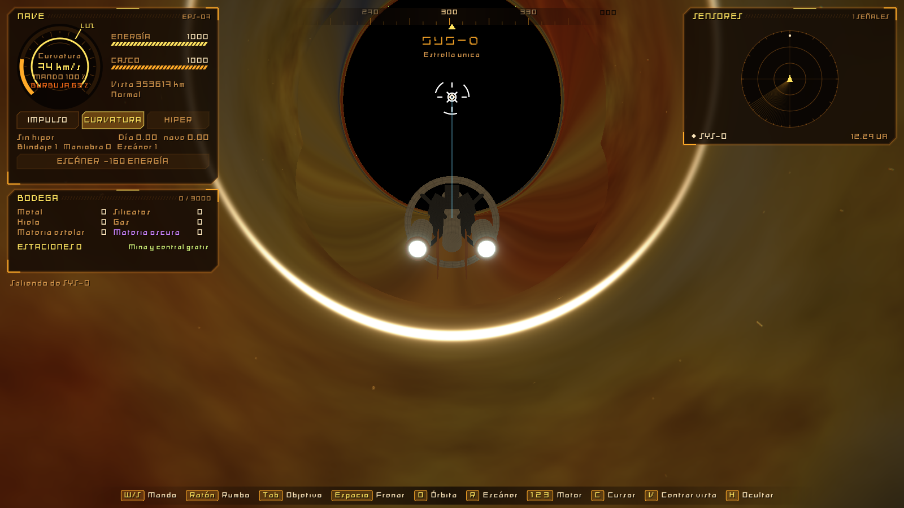

Ya en marcha, se usa la aberración relativista real: cerca de c, todo el cielo se comprime hacia delante, así que en el campo de visión cabe casi la esfera entera. Por eso se ve la luz azul al frente, el arcoíris alrededor, el rojo hacia los bordes y el negro detrás. Los colores concretos son una representación, porque la luz real saldría del espectro visible.

### Mapa

M abre el menú de sistemas, que se puede elegir también en la rueda. A la izquierda, la lista por secciones: **Visitados** y **Localizados**. El sistema elegido se abre y enseña sus estrellas, sus planetas con las lunas debajo, los campos de asteroides, las anomalías vistas y las estaciones propias. Lo que no se ha analizado aparece como `Sin analizar`. A la derecha, los datos de lo elegido, y un botón que lo fija como objetivo. Vale para sistemas lejanos: los datos analizados se conservan aunque el sistema no esté en memoria.

En el centro hay un modelo en 3D. Se gira arrastrando con el ratón y se acerca con la rueda:

- **Sistema.** Las órbitas reales, a escala real y con su inclinación y excentricidad. El planeta elegido es el centro del zoom, y sus lunas aparecen al acercarse. Un clic en un astro lo elige. También se marcan las anomalías vistas y la nave.
- **Astro.** La esfera real, con su superficie, su giro y su atmósfera, y las órbitas de sus lunas al alejarse. Una estrella lleva su corona con el mismo cálculo que en el juego, un poco atenuada para que el disco se siga viendo: un halo cálido que se apaga sin borde, serpentinas tenues y el filo rojizo de la cromosfera. Solo está disponible la superficie real en el sistema donde estás; en otro se ve un globo de su color.

La rueda del ratón acerca cambiando el enfoque, no moviendo la cámara: así las órbitas no se deforman al pasar entre ellas. Arrastrar gira en el sentido de la mano, como la cámara de la nave.

**Elementos.** Planetas, lunas, asteroides y estrellas tienen su composición por elementos, en porcentaje de masa: hidrógeno, helio, carbono, nitrógeno, oxígeno, magnesio, aluminio, silicio, azufre, calcio, hierro y níquel. Sale de sus materiales con recetas reales: un núcleo de hierro y níquel, rocas como el manto terrestre, agua, hielos de metano y amoníaco, y gas como el del Sol. Las estrellas usan su hidrógeno, su helio y los metales en proporción solar; los campos de asteroides, lo que daría una mina. Se ve en los datos del mapa y del análisis.

**Tabla periódica.** El botón **Tabla periódica** del mapa, o **Ver los 118 elementos** en los datos, enseña el porcentaje en masa de todos los átomos de lo elegido, del hidrógeno al oganesón, en su sitio de la tabla. El color de cada casilla dice cuánto hay en escala logarítmica, y al pasar el ratón sale el valor exacto, en ppm o ppb si es una traza. Los doce de arriba salen de las recetas. El resto sale de las abundancias de las condritas CI y del Sol (Lodders, 2003), repartidas según a qué se une cada elemento: los siderófilos, como el platino o el oro, van con el hierro; los calcófilos, como el cobre o el plomo, con el azufre; los litófilos, como las tierras raras o el uranio, con la roca; los volátiles, con el agua y los hielos; y los gases nobles, con el helio. Los hijos radiactivos del uranio, como el radio o el polonio, salen del equilibrio secular. Cada astro se aparta un poco de la media según su semilla, y a veces tiene una veta de un elemento escaso. Del 95 en adelante no hay nada: solo se fabrican. Servirá para diseñar tecnología y piezas.

**Superficies.** El color de la roca sale de esos elementos: el hierro la oscurece, el magnesio, el aluminio y el calcio la aclaran, el azufre la amarillea y el carbono la ennegrece. Los mundos rocosos tienen mares de basalto oscuro, con menos cráteres, y cráteres en cuatro escalas, más cuanto menos aire tienen. Cada cráter tiene un perfil real: un cuenco hondo, con fondo plano y pico central si es grande, un borde levantado y un manto de eyecta que se apaga hacia fuera. Hay muchos más pequeños que grandes, ninguno es un círculo perfecto, los viejos están gastados y los nuevos, más claros, se montan encima y borran lo que había. El relieve tuerce la luz, así que se ven sus sombras, y sin aire el polvo devuelve la luz como la Luna: el disco no se oscurece hacia el borde y la sombra corta en seco. Además de cráteres, la roca y el hielo tienen colinas, cordilleras de crestas afiladas y fracturas largas; en los mundos helados, como Encélado, las fracturas abundan y se tiñen de azul donde aflora hielo limpio. Los mundos con agua tienen cordilleras con relieve, costas turquesa, vegetación que se apaga hacia los polos, desiertos en las latitudes secas y el reflejo del sol en el mar. Sus **nubes** tienen volumen: frentes estirados por el viento, ciclones que las enroscan al revés en cada hemisferio, jirones y cúmulos de cerca; la luz modela sus cimas y cada nube proyecta su sombra sobre el suelo, desplazada lejos del sol. Los gigantes tienen bandas de anchura desigual con estrías, remolinos en los bordes entre bandas, óvalos blancos y una gran tormenta que tuerce las bandas a su alrededor. En el mapa la luz llega de lado, para que se vea el relieve. El borde de un planeta se funde con su atmósfera, sin la línea oscura de un píxel que quedaba entre ambos.

**Atmósfera.** Los datos de un planeta dicen si tiene aire, lo denso que es y de qué está hecho: dióxido de carbono en un desierto, nitrógeno y oxígeno en un mundo con vida, vapor de roca en uno de lava, hidrógeno y helio en un gigante. El brillo del borde sigue una escala logarítmica, de 0,1 milibares a 1 bar, así que un aire fino como el de Marte también se ve. Un planeta achatado por su giro tiene la atmósfera ceñida a su forma, también el resplandor que deja en la niebla, que antes era un círculo y dejaba un hueco sobre los polos. En los gigantes el aire visible es una bruma fina sobre las nubes.

### Escáner

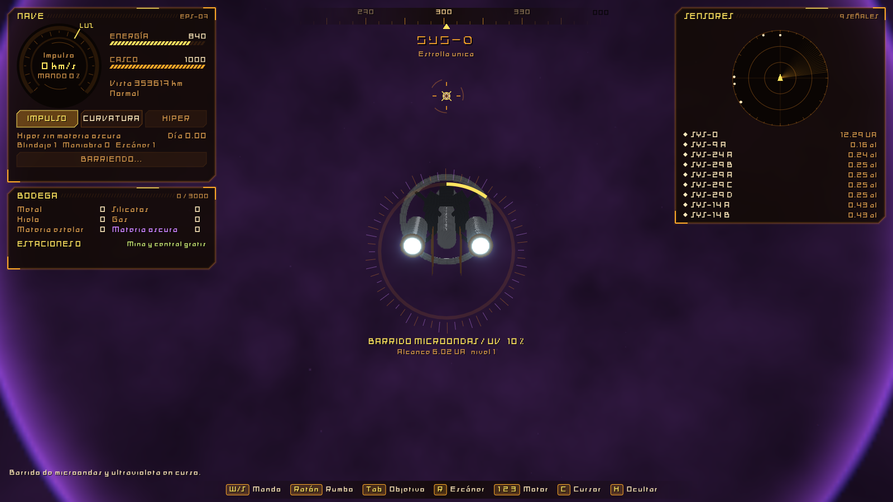

Los sensores normales ven lo que emite. Las estructuras abandonadas llevan eones apagadas: para ellas hace falta el barrido de microondas y ultravioleta.

Tampoco se conoce otro sistema hasta que un barrido lo localiza o se llega a él. Al empezar solo aparece el tuyo.

**Sin barrido no se sabe nada de un astro**: es una señal sin identificar, sin recursos ni datos, y no se puede desplegar en él. El barrido analiza todo lo que hay a unas 40 UA en este sistema. Análisis, en la rueda, abre sus datos:

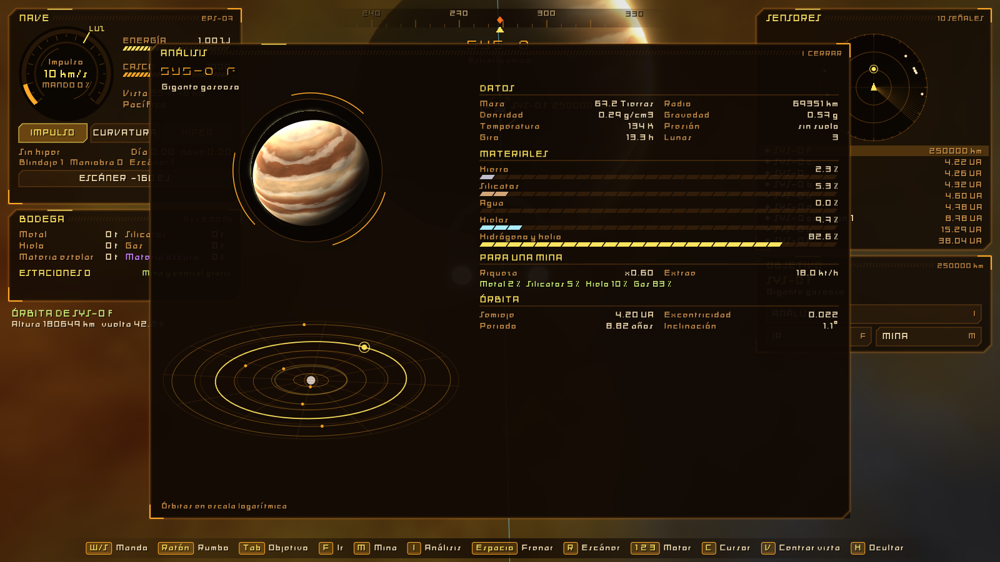

- La esfera real del astro, girando.
- Un holograma del sistema con todas las órbitas, en escala logarítmica y con el astro resaltado.
- Sus datos, composición y órbita.
- Lo que daría una mina o una central.

- La nave debe estar **quieta o en órbita**. Si enciende el motor, el barrido se pierde.
- Gasta **160 EJ** y dura 30 segundos.
- Encuentra anomalías a **6 UA** con el nivel 1, y localiza sistemas a unos **0,17 años luz**. Todo llega más lejos con cada nivel.
- Lo mejor escondido pide más nivel: el barrido avisa de una señal débil.

La estructura del sistema inicial está lejos de la nave al empezar, así que hay que moverse y repetir. `escaner 3` prueba otro nivel desde la consola.

### Combate

La nave sale con una arma de cada familia. Cada una hace un tipo de daño distinto, para que los escudos de la etapa siguiente tengan donde elegir:

| Arma | Daño | Alcance | Recarga | Coste | Cómo funciona |
|---|---|---|---|---|---|
| Torreta | Cinético, 20 | 150 000 km | 3 s | 0,4 EJ | Proyectil a 4000 km/s. Derriba misiles y drones que se acerquen |
| Cañón espinal | Fotónico, 260 | 500 000 km | 40 s | 60 EJ | Haz de luz a c, **fijo al eje del casco**: hay que girar hasta la solución antes de disparar |
| Misil | Antimateria, 180 | 1 200 000 km | 10 s | 0,2 kt de antimateria | Guiado, lento (hasta 1500 km/s) y con mucho alcance; gira a 0,05 rad/s |
| Drones | Térmico, 18 ×6 | 600 000 km | 25 s | 1 kt de metal | Enjambre guiado de seis; si no los derriban, queman el casco |

Los tiempos son simulados: en combate el reloj se frena, y unos 10 segundos reales son unos 90 simulados. Cada nivel de arma suma un 40 % de daño y acorta un 10 % la recarga.

**En pantalla.** Al fijar una nave o un bastión, el panel de objetivo muestra su casco y una fila por arma: LISTA, los segundos de recarga, o lo que falta (LEJOS, SIN METAL, GIRA 3,2°). Con el cursor activo, cada fila dispara esa arma. El rombo verde marca adónde debe mirar el casco para el cañón espinal. Cada proyectil cercano lleva una marca, roja si viene hacia ti, y un aviso central cuenta el fuego entrante y su distancia. Las estelas salen del arma y cada tipo de daño tiene su color: amarillo cinético, azul fotónico, magenta antimateria y naranja térmico.

**Computador de puntería.** El blanco está a cientos de miles de km y mide menos de 1, así que no se apunta a mano. El computador resuelve la intercepción (velocidad del tirador, del blanco y tiempo de vuelo) y la corrige con un método de tiro: simula el vuelo con la gravedad que conoce y desplaza el punto de mira hasta que acierta. El **nivel del computador** decide cuántos astros cuenta (1, 3, 5, 7 o 9), cuántas correcciones hace y cuánto se equivoca al final: el error baja con el nivel elevado a 1,5. Lo que no cuenta, desvía el tiro. Las armas guiadas no necesitan puntería; el cañón espinal tampoco se equivoca, pero no gira.

**Gravedad y luz.** Los proyectiles siguen la gravedad real de los planetas y estrellas del sistema; los haces de luz se desvían el doble, como en la relatividad. Junto a una estrella, un tiro recto falla por cientos de km. Los proyectiles que fallan **siguen su camino**: caen a un planeta, orbitan o vuelven a cruzar el sistema, y pueden dar a quien disparó o a un tercero. Un astro que se cruza los detiene.

**Impactos.** Un proyectil cuenta como impacto a cierta distancia del blanco (de 4 a 40 km, según el arma). El daño recibido pasa por un único cauce, `Hurt`, que aplica el multiplicador del modo. En Pacífico nada dispara, pero se puede cazar. Las naves destruidas sueltan metal y los bastiones, más.

Los enemigos usan las mismas reglas: una nave hostil dispara torretas con un computador de nivel 1, y un bastión lanza misiles. Disparar a una nave neutral la vuelve hostil. Las armas valen contra cualquier bando, no solo contra el jugador: es la base para que luego peleen entre sí.

### Escudos

Cinco defensas con ventajas cruzadas, del documento de especificación. Cuatro son **campos**, y solo uno va encendido a la vez: K los recorre. Los **conos ablativos** son placas en la proa, sin energía, y van siempre puestos.

| Defensa | Para de cada impacto (cinético, fotónico, antimateria, térmico) | Aguanta | Coste e inconveniente |
|---|---|---:|---|
| Arena magnética | 15 %, 90 %, 40 %, 85 % | 350 | 2 kt de silicato por hora y un poco por cada golpe parado; sin silicato no funciona. Absorbe calor |
| Plasma | 95 %, 30 %, 30 %, 10 % | 300 | Calienta la nave, y los hostiles la ven desde **tres veces más lejos**. Vaporiza los asteroides de menos de 500 m al chocar |
| Electromagnético | 0 %, 55 %, 95 %, 50 % | 400 | Gasta 900 EJ por hora mientras está encendido, casi la mitad de lo que da el reactor. **Triplica el error de puntería enemigo**, incluido el del haz |
| Conos ablativos | 60 %, 30 %, 30 %, 50 %, solo lo que llega **por delante** | 500 | Pesan: con las placas enteras la nave maniobra un 23 % peor. El gas de la nebulosa las gasta con la velocidad |
| Campo de Amor | Todo | Sin límite | Devuelve al atacante el daño que no es luz, y lo convierte en casco y energía. Solo de los Unicornios; hoy, con `creativo` |

Un impacto pasa primero por el campo y lo que queda, si viene por delante, por los conos; el resto llega al casco. Los campos se recargan solos, despacio; las placas se reponen en una estación propia, con metal. El registro dice cuánto pararon los escudos en cada ráfaga.

**Presión de ariete.** En curvatura por encima de la luz, el gas de la nebulosa golpea la proa. Los conos la aguantan gastando placas; sin ellos, se lleva casco: unos 24 por minuto real a 10 c con la niebla normal, y más cuanto más rápido y más espesa.

**Escudos alienígenas.** Las naves llevan arena, plasma o electromagnético, según cada una; los bastiones, electromagnético. El panel de objetivo enseña su escudo y, en cada arma, qué parte lo atraviesa: contra el plasma conviene la luz o la antimateria, y contra el electromagnético, la torreta.

### Calor

El calor sube al disparar (el cañón espinal mucho más que la torreta), al parar golpes con un escudo, con el plasma encendido, al formar una burbuja y mientras dura, según la velocidad, y en la zona de calor de una estrella. **Por encima del 100 %** los escudos y las armas dejan de funcionar, el casco se funde poco a poco y el tiempo se frena para dar tiempo a salir.

| Sistema | Quita | Se gasta | Notas |
|---|---|---|---|
| Radiadores infrarrojos | 0,35 por segundo | Nada | Siempre funcionan, pero junto a una estrella apenas sirven: por debajo de 12 radios pierden eficacia con el cuadrado de la distancia |
| Agua | Hasta 1,5 por segundo | 60 de depósito | La más barata. Se rellena al fundir hielo y en las estaciones propias, con hielo de la bodega |
| Hielo | Hasta 1 por segundo | Hielo de la bodega | Se funde en la nave, y el agua que deja va al depósito |
| Nitrógeno líquido | Hasta 4 por segundo | 40 de depósito | El que más quita. Se evapora solo, despacio, y con la nave fría se licua del gas de la bodega con energía |

Los que se gastan solo entran por encima del 40 %, primero los baratos. El panel de la nave muestra el escudo encendido, las placas de proa y el calor, con el agua, el nitrógeno y la eficacia de los radiadores. Todas las cifras están en [Balance.h](include/game/Balance.h), en `DefenseRules` y `ThermalRules`.

### Estaciones

| Estación | Dónde | Gratis | Después |
|---|---|---|---|
| Mina | Planetas y campos de asteroides | Mientras tengas menos de 3 | 150 kt de metal y 80 kt de silicatos |
| Central | Estrellas y agujeros negros | Solo la primera | 300 kt de metal y 200 kt de silicatos |

Lo que da una mina sale de la composición real del sitio. Las dos producen solas, aunque estés en otro sistema, y guardan lo producido. **Hay que ir en persona a recogerlo**; `relayTier` deja preparado el enlace a distancia para más adelante. En órbita de una central propia, además, se repara el casco.

Cada estación tiene 4 huecos y cada módulo llega al nivel 5: taladro y tolva en la mina; colector, condensador y cuchara en la central.

Al desplegarla, las piezas salen de la nave por un haz y se montan una tras otra durante 6 segundos.

### Cinturones

Dentro de la nebulosa solo se ve a unos cientos de miles de km, y las familias de asteroides de un cinturón quedan a millones de km unas de otras: antes, dentro del cinturón solo se veía un cúmulo suelto. Ahora el anillo existe alrededor de la nave, esté donde esté dentro de él (`BeltField`, en [Asteroids.h](../engine/include/epsilon/Asteroids.h)):

- **Polvo:** puntos que forman la banda hasta 220 000 km, más densos en el plano y en el centro del anillo.
- **Rocas sueltas:** de 0,1 a unos pocos km, con su malla, hasta 15 000 km; una cada 2000 km más o menos en un cinturón normal. Son sólidas, como las de las familias.
- **Familias:** más grandes, de 250 a 610 km de radio según el perfil, con cinco veces más rocas (unas 4000 en uno normal), casi igual de apretadas que antes. Sus órbitas son menos excéntricas (0,05 de media y 0,15 como mucho, antes 0,09 y 0,3), así que se quedan dentro del anillo: antes la más cercana a la estrella solía quedar muy por dentro del borde, donde no había nada más.
- Dentro de la nebulosa el fondo es claro, así que el polvo y las rocas lejanas se ven como motas oscuras, más grandes cuanto más cerca.

El anillo se divide en celdas que giran con la velocidad orbital de su radio, y cada celda saca sus rocas de su semilla: se mueven en órbitas circulares y alrededor de un punto aparecen siempre las mismas, sin guardar nada. Sigue siendo mucho más apretado que un cinturón real, en el que entre roca y roca hay cerca de un millón de km: así hay algo que ver y que esquivar.

### Estrellas

Lo que da cada una depende de su luminosidad, y entrar en su órbita depende del blindaje, que empieza en nivel 1:

| Estrella | Blindaje | Potencia | Materia |
|---|---:|---:|---|
| M, K | 0 | Baja | Poca |
| G, F | 1 | Media | Poca |
| A, enana blanca | 2 | Alta | Normal |
| Gigante roja | 2 | Según su luz | ×4 |
| B, supergigante roja | 3 | Muy alta | Supergigante ×8 |
| O, estrella de neutrones, supergigante azul | 4 | Máxima o 139 PW | Supergigante ×6 |
| Agujero negro de Schwarzschild | 4 | Unos 110 PW | 20 kt/h |
| Agujero negro de Kerr | 5 | Hasta 3 veces más, según su giro | 20 kt/h |

Sin blindaje no se puede desplegar, y entrar en esa zona quema el casco.

### Alienígenas y estructuras

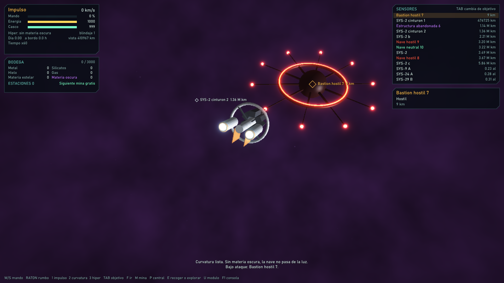

Las neutrales patrullan y no hacen nada, hasta que alguien les dispara. Las naves hostiles te persiguen a 300 km/s si te acercas a 3 millones de km, se quedan a unos 80 000 km y disparan torretas: se escapa con la curvatura. Los bastiones no se mueven y lanzan misiles a lo que entra en su alcance. Todas se pueden destruir (ver Combate); las estructuras abandonadas no.

Cada estructura guarda un emisor de energía negativa. Sacarlo lleva 2 horas simuladas, unos 2 minutos reales, con la nave quieta a su lado; la bodega muestra los que llevas.

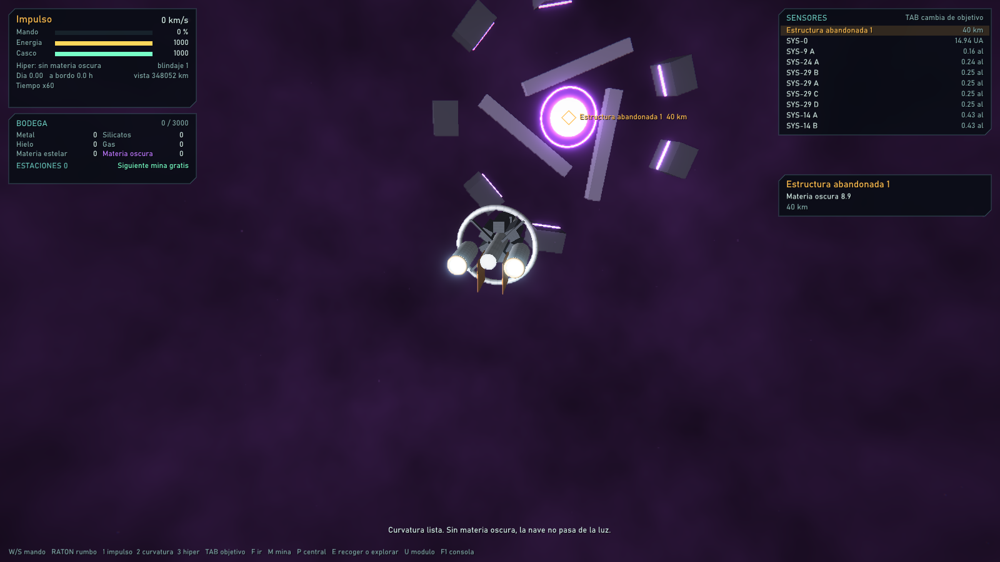

## Tutorial

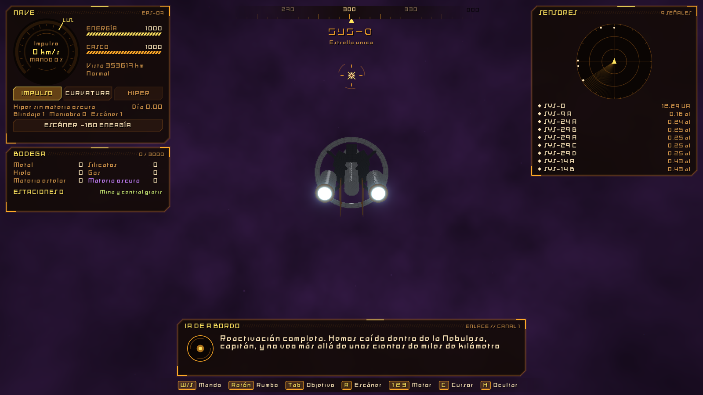

El primer sistema enseña lo básico con diálogos de la IA de a bordo, escritos letra a letra: manejo, cursor, escaneo, análisis, mina, central, recoger y estructura. Cada paso espera a que lo hagas, y el juego no se detiene mientras tanto. `Dialogue` sirve para cualquier otra conversación: basta con darle otra lista de pasos.

## Interfaz

Naranja y amarilla, con [Audiowide](assets/fonts/OFL-Audiowide.txt) para el texto y los títulos, y [Rubik Glitch](assets/fonts/OFL-RubikGlitch.txt) para todo lo alienígena: nombres de naves, bastiones y estructuras, y el aviso de fuego entrante. El título del menú, Epsilon-Z, va en [Hangul](assets/fonts/OFL-Hangul.txt), de Sébastien Hayez: se escribe `3PSiLgn-Z` para que se vea «3psilon-z», estirado y en cursiva. Las tres tienen licencia OFL, que permite incluirlas en el juego; sus licencias van junto a ellas. Tiene cinta de rumbo, reloj de velocidad con la marca de la luz, radar 3D, panel de sensores, objetivo y bodega, punto de mira con el rumbo real y el apuntado, anillo de giro, y una barra con las teclas que sirven en cada momento. El punto de mira va aparte, en [reticle.hlsl](shaders/reticle.hlsl), porque necesita leer la imagen.

El **radar 3D** va siempre abajo, en el centro, encima de las teclas. Es un disco visto en perspectiva, en los ejes de la nave (delante es el fondo del disco), con **cinco capas de altura**: el plano de la nave en el medio, y dos por encima y dos por debajo, cada una de 36° de elevación. Cada señal va en su capa, con un tallo hasta el plano: triángulo hacia arriba si está encima, hacia abajo si está debajo, rombo si está a su altura; hueca si está más lejos que el alcance. La distancia va en escala logarítmica, cuatro décadas hasta el alcance, que se cambia con − y + (de 10 km a 10¹³ km). Con el cursor (C), al pasar por una señal sale su nombre y su distancia, y un clic la fija como objetivo.

El panel **Estructura**, abajo a la derecha, es el casco visto desde arriba, zona a zona, con las zonas rojas recuadradas en rojo y lo que queda de empuje, curvatura, radiadores, maniobra y puntería (ver Casco por zonas).

Con C, el ratón pasa a manejar la interfaz: se puede elegir motor, tocar un contacto de la lista o del radar, lanzar el escáner y dar órdenes al objetivo. La nave mantiene su rumbo mientras tanto.

## Probar rápido

| Comando | Efecto |
|---|---|
| `objetivo planeta` | Fija el objetivo. También: `campo`, `estrella`, `estacion`, `estructura`, `hostil`, `neutral`, `bastion`, `refugio` |
| `saltar estructura 40` | Lleva la nave a 40 km del objetivo |
| `ir`, `mina`, `central`, `usar`, `escaner` | Lo mismo que esas opciones de la rueda |
| `motor crucero`, `mando 100` | Cambia de motor y acelera |
| `regalo 2` | Da 2 emisores de energía negativa y recursos |
| `creativo [si\|no]` | Modo creativo: nave invulnerable, energía, antimateria y materiales sin fin, todos los motores y niveles (también los escudos, el Campo de Amor incluido), todos los sistemas localizados y analizados. Los choques siguen frenando la nave, pero sin daño. El calor sigue contando, para probarlo. No se guarda |
| `aparecer hostil 2000 3` | Crea delante de la nave, a esa distancia y en esa cantidad: `hostil`, `neutral`, `bastion`, `estacion` o `estructura` |
| `buscar terrestre [n]` | Lleva la nave junto al primer astro (o el n-ésimo) de una clase: `terrestre`, `hielo`, `lava`, `roca`, `desierto`, `gaseoso`, `helado`, `caliente`, `luna` |
| `viajar 12` | Lleva la nave a la estrella del sistema 12 |
| `emisores 5`, `nivel armas 4` | Fija los emisores o un nivel: `escaner`, `blindaje`, `maniobra`, `computador`, `armas`, `enlace` |
| `destruir` | Destruye la anomalía objetivo |
| `escudo plasma` | Enciende un campo: `arena`, `plasma`, `em`, `amor` (si lo tienes) o `no`. Sin argumento, el siguiente, como K |
| `nivel conos 3`, `nivel nitrogeno 2` | Nivel de un escudo (`arena`, `plasma`, `em`, `conos`, `amor`) o de un refrigerante (`agua`, `hielo`, `nitrogeno`, `radiadores`); 0 lo quita |
| `calor 120` | Fija el calor; 100 es el límite |
| `refrigerante hielo no` | Enciende o apaga un refrigerante |
| `blindaje 5`, `maniobra 3`, `escaner 3` | Cambia un nivel |
| `casco 0` | Destruye la nave |
| `tiempo 600` | Acelera el tiempo |
| `vista 150 4` | Coloca la cámara: grados y km |
| `girar 0 130` | Gira la nave de golpe: grados a la derecha y hacia abajo |
| `orbitar` | Lo mismo que Órbita en la rueda |
| `disparar [torreta\|espinal\|misil\|drones]` | Dispara una familia, o todo lo listo, al objetivo |
| `apuntar [arma]` | Gira el rumbo a la solución de tiro una vez; por defecto, la del cañón espinal |
| `alinear` | Lo mismo que B |
| `computador 3` | Cambia el nivel del computador de puntería |
| `atracar`, `atracar ya`, `soltar` | Atraca en la estación objetivo; con `ya`, sin esperar al haz |
| `apie`, `abordo`, `vistapie` | Baja a la cubierta, vuelve desde cualquier punto, cambia la vista |
| `astro 5` | Fija como objetivo el astro número 5 de este sistema |
| `revelar` | Analiza todo el sistema, sin escanear |
| `trayectoria` | Muestra u oculta la línea de la ruta que lleva la nave, como en la rueda |
| `radar 3` | Alcance del radar, de 0 (10 km) a 10 (10¹³ km) |
| `dano`, `dano 9 310`, `dano 8 60 1 0 0` | Lista las zonas del casco con su integridad. Con zona y cantidad, golpea esa zona como un impacto sin escudos (el casco entero son 1000); con `x y z`, el golpe llega desde esa dirección del modelo. `dano 1 400` apaga la nave por el puente |
| `taller`, `modulo`, `modulo 0 1`, `impulsor 3` | Abre el taller. `modulo` lista ranuras y tipos; `modulo <ranura> <tipo>` monta (0 quita); `impulsor <1..4>` cambia el motor de impulso. Atracada, o en cualquier sitio en creativo |
| `disparo 0 0 1 -150 0 -380 60` | Un proyectil sin escudos que llega desde la dirección `dx dy dz` y pasa por el punto `px py pz` (m, en el modelo), con ese daño. Dice en qué zona da |

`--mode 0` a `--mode 4` salta el menú, y `--no-tutorial` quita los diálogos. `--page 0` a `--page 3` abre una página del menú, y `--quality 0` a `--quality 3` fuerza una calidad gráfica. `--save a.sav` usa otro archivo de partida y `--load` lo carga sin pasar por el menú; con `--frames` no se guarda nada salvo que se indique `--save`. `--nave a.glb` usa ese modelo para la nave.

## Cómo está hecho

| Archivo | Responsabilidad |
|---|---|
| [Balance.h](include/game/Balance.h) | **Todas las cifras** y los modos de juego |
| [Economy.h](include/game/Economy.h) | Recursos, yacimientos y lo que da cada estrella |
| [Ship.h](include/game/Ship.h) | Motores, manejo, energía y casco |
| [Stations.h](include/game/Stations.h) | Minas, centrales, módulos y las estaciones gratis |
| [Anomalies.h](include/game/Anomalies.h) | Alienígenas y estructuras, con casco y arma |
| [Combat.h](include/game/Combat.h) | Proyectiles, balística con gravedad y computador de puntería |
| [Defense.h](include/game/Defense.h) | Escudos, calor y refrigeración |
| [OnFoot.h](include/game/OnFoot.h) | Cubiertas y tripulantes, a pie |
| [Humanoid.h](../engine/include/epsilon/Humanoid.h) | Motor de personas: andar, saltar y chocar, en metros |
| [Tutorial.h](include/game/Tutorial.h) | Diálogos y objetivos |
| [Session.h](include/game/Session.h) | Une todo en una partida, sin ventana ni GPU |
| [SaveGame.h](include/game/SaveGame.h) | Formato del archivo de partida |
| [GameModels.h](include/game/GameModels.h) | Modelos provisionales |
| [GameLayer.h](include/game/GameLayer.h) | Modelos, nubes, polvo, destrucción y lente |
| [warp.hlsl](shaders/warp.hlsl) | Lo que se ve dentro de la curvatura |
| [GameHud.h](include/game/GameHud.h) | Interfaz |
| [main.cpp](src/main.cpp) | Ventana, teclas y comandos |

La lógica no conoce SDL ni la GPU, así que [tests/game_tests.cpp](../tests/game_tests.cpp) juega partidas enteras sin ventana.

Los modelos son maquetas hechas por código. Para cambiar uno por el tuyo, carga un `.glb` con `LoadGltf` y `BuildModel`, y sustitúyelo en `GameAssets`. Las piezas `mod_1` a `mod_4` son las que aparecen al instalar módulos.

## Falta por decidir

1. **Mejoras de la nave:** blindaje, sensores, bodega, maniobra y escáner aún no se suben jugando.
2. **Coste de los módulos:** hoy solo piden metal. Falta dar uso al hielo, al gas y a la materia estelar.
3. **Alienígenas:** comercio con neutrales y si atacan a tus estaciones. Las armas, los escudos y los refrigerantes ya existen, pero sus niveles aún no se suben jugando (hoy, `nivel`): llegarán con los componentes de las facciones.
4. **Objetivo del juego.**
